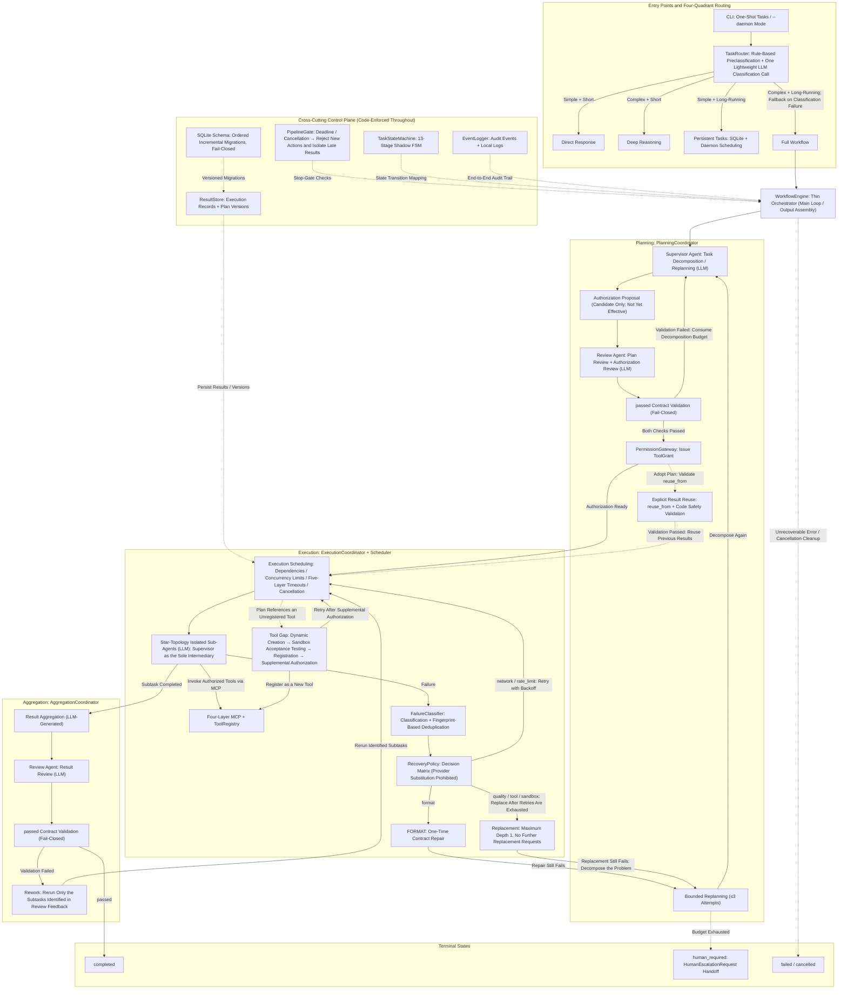

<div align="right">
  <a href="README.md">
    
  </a>
</div>

<h1 align="center">SO-Agent</h1>
<p align="center">
  <b>A Governed Multi-Agent Execution Runtime</b><br>
  <i>LLMs think, Code decides.</i>
</p>

A governed multi-agent execution runtime: a two-tier, star-topology multi-agent orchestration framework built on the [OpenAI Agents SDK](https://github.com/openai/openai-agents-python). The core design principle is **LLM-as-Thinker, Code-as-Decider** — the LLM understands goals, decomposes tasks, generates instructions, and analyzes content; all decisions such as state transitions, permission issuance, retry control, and execution scheduling are made by the deterministic code layer.

> **Project status: experimental / research use.** Not production-ready; interfaces and behavior may change at any time. Test counts and capability claims reflect the current code snapshot and are not permanent guarantees.

- Architecture document (English): [SO_Agent_Execution_Runtime.md](./SO_Agent_Execution_Runtime.md)
- 中文架构文档：[多_Agent_框架.md](./多_Agent_框架.md)

# Architecture Overview

The diagram below provides an overview of the current implementation architecture, covering implemented capabilities only. Requests enter through a four-quadrant routing layer. The full workflow is driven by a thin orchestrator and three coordinators for planning, execution, and aggregation.

The implemented capabilities include two-stage reviews; the complete lifecycle from authorization proposals to ToolGrant issuance; deterministic failure recovery; star-topology isolation for sub-agents; dynamic tool creation and sandbox acceptance testing; and a cross-cutting control plane spanning the entire workflow, including a stop gate, a shadow state machine, audit events, ResultStore with schema migrations, and human escalation.

Solid lines represent the primary task flow. Dashed lines represent conditional paths and intervention points for the cross-cutting control plane. Deferred and planned directions—including multidimensional budgets, context governance, production container sandboxes, Temporal, and quota-managed ModelGateway—are excluded from the diagram. See Capability Status and Roadmap below for details.


## Responsibility Boundaries

LLMs—including the supervisor, review agents, and sub-agents—are responsible only for semantic understanding, task decomposition during planning, review feedback, and content generation.

All task state transitions, permission issuance and revocation, scheduling, timeout enforcement, cancellation, failure recovery policies, and the final passed release decision are determined by the deterministic code layer.

Review decisions take effect only after passing contract validation in the code layer. The validation process follows a fail-closed policy: a review decision that fails validation cannot authorize the workflow to proceed.

## Diagram Scope

The diagram intentionally includes only implemented capabilities. The following directions are deferred or planned and are not represented as implemented functionality:

- Multidimensional budgets
- Context governance
- Cloud sandboxing / microVM isolation
- Temporal-based workflow orchestration
- A quota-managed ModelGateway (multi-provider failover is implemented)

## Core Features (Implemented)

All capabilities below are implemented in the current code and covered by **2032 tests (current snapshot)**:

- **Four-quadrant task routing**: rule-based pre-check plus one lightweight LLM classification; tasks are dispatched along the complexity × duration quadrants to direct answer / deep reasoning / persistent task / full workflow paths. Classification failure conservatively degrades to the full workflow.
- **Two-tier star architecture**: the Supervisor Agent exclusively holds exactly three tool entries (code_agent, subagent_creator, review_agent); subagents have no message channels or shared sessions — all communication is relayed by the Supervisor.
- **Thin orchestrator + three coordinators**: WorkflowEngine keeps only the main loop and human escalation; planning (decomposition and plan review), execution (scheduling and failure escalation), and aggregation (synthesis and result review) belong to three coordinators exchanging state via a shared state object.
- **13-phase shadow FSM**: a python-statemachine declarative state chart mirrors the authoritative task status; all legal transitions are declared explicitly, illegal ones are rejected and logged.
- **Two-stage review**: plan review and result review both produce a structured ReviewDecision; `passed` is the only approval field and the gate is fail closed — an invalid contract or parse failure is conservatively treated as rejection; `suggestions` are non-blocking and never a rejection reason.
- **Tiered and parallel result review**: `result_review_mode` supports `always` (default) / `risk_based` / `off`; `risk_based` skips semantic review only when there are no acceptance criteria, no write side effects, no replan/rework history, and deterministic coverage is complete, recording the reason in `review_skipped`; `result_review_parallel_with_aggregation` is enabled by default and runs aggregation and result review concurrently to cut fixed tail latency.
- **Deterministic parallelism with time-first objective**: plan shape is compiled deterministically from the dependency graph; G1 shape / G2 independence (write conflicts or undeclared scopes fail closed) / G3 gain are decided up front, and G4 runtime breaker collapses remaining subtasks to serial after provider-type failures or a consecutive-failure streak. `optimization_objective=time_first` (default) trades a lower net-gain threshold for more parallel work while enforcing a minimum wall-clock speedup, so large token spend for negligible time savings is rejected; `token_first` keeps the stricter 1.30 gate. Actual speedup and thresholds are recorded in the `parallelism_decided` event.
- **Simple plan review skip**: `skip_plan_review_for_simple` is enabled by default and skips the LLM plan review only for the first plan with at most two subtasks, no dependencies, approved/assignable tools, and machine-checkable verification on every write subtask, recording the reason in `review_skipped`; replans, unapproved tools, or missing verification always take the full review path.
- **Single-file lightweight fast path**: `fast_path_single_file_enabled` is off by default. When enabled it applies only to "write one text file" tasks with no run/install/network/multi-file action: one lightweight model call generates the body, and the control layer performs path containment, symlink rejection, atomic write, size and required-content checks before completing without supervisor planning or execution. Any uncertainty or failure (empty body, tool markup, missing required text, write error) falls back to the full workflow and records a `fast_path` event — it never fabricates success.
- **Supervisor tool-list slimming**: `supervisor_context_slimming` is on by default; planning payload `available_tools` keeps only `name` plus a description truncated to `supervisor_tool_description_max_chars`. Every listed tool is already approved and assignable, so `source` / `approved` add no planning decision value.
- **Asynchronous provisional delivery**: low-risk plans with no external side effects and complete deterministic coverage may deliver results first (`completed_provisional`) while review continues in the background; a failed review triggers at most one automatic rework and a re-review, the revised output keeps the old version in `previous_result`, and exhaustion escalates to human; tasks with acceptance criteria, write side effects, or failure history always stay synchronous and are never delivered before review.
- **Authorization proposal with deferred issuance and revoke-on-all-exits**: tool grants are issued by the code layer only after the plan review passes (proposal → grant); every exit — task completion, replacement, re-planning — revokes outstanding grants.
- **Deterministic failure recovery**: FailureClassifier categorizes failures (low-trust agent text cannot forge system failure categories), failure fingerprints deduplicate retries (retries suppressed once the same-cause streak reaches the threshold), and RecoveryPolicy decides retry / repair / replacement / replanning per category; provider-type failures forbid replacement, and FORMAT failures allow exactly one contract repair before entering REPLAN.
- **Write-scope acceptance**: subtasks declare `write_scope` (sandbox-relative paths with wildcard support); after execution the control layer verifies declared artifacts against the filesystem, flips self-reported success to failure when files are missing, and applies the same semantics to parallel write-conflict checks.
- **Machine-checkable acceptance rules**: `SubtaskSpec.verification` supports `file_exists` / `file_non_empty` / `json_field` / `numeric_match` / `text_contains` / `exit_code`; rules are evaluated deterministically after execution, and any failure flips the success flag and records `verification_failed`.
- **Postcondition and execution-evidence checks**: code_agent `create` / `modify` must produce existing non-empty files and `execute` must carry a successful sandbox result; successful subtasks claiming artifacts must show a completed tool invocation for the current attempt, otherwise they are flipped to failure before returning to the Supervisor.
- **Replacement-chain depth 1 and bounded replanning**: up to 3 attempts per agent, the original subagent may request a replacement only once, replacement agents cannot request further replacements, and the Supervisor may revise the decomposition at most 3 times (with explicit `reuse_from` reuse of prior results) before entering the `human_required` state.
- **Five-layer streaming timeout design (liveness-only by default)**: first-event / model-idle / tool-execution windows are enabled by default to detect stream stalls and hangs; per-agent total budgets and the absolute pipeline deadline are disabled by default (`0`), so normal tasks are never killed by a fixed total duration. The PipelineGate rejects every new action after an explicitly enabled deadline or cancellation and isolates late results.
- **Activity watchdog**: any SDK stream event, tool lifecycle transition, subtask completion, phase transition, or checkpoint resets the watchdog; only `pipeline_no_progress_timeout` seconds of complete inactivity count as a stall, and bounded retries / replanning / checkpoint resume prevent infinite loops.
- **Tool timeout profiles**: standard tools, nested subagents, and the long-running code agent use dedicated tool-phase wait windows; parent-level windows for nested/code agents are disabled by default and liveness is enforced by the child's own idle windows and turn limits.
- **Dynamic tool generation and MCP layer**: tools generated by code_agent must prove correctness via test_cases and pass per-case semantic verification in the sandbox before registration; the protocol layer provides an MCP server, client, and bidirectional adapters.
- **Persistence and schema migration**: SQLite stores long-running tasks, execution records (Execution), and plan versions (PlanVersion); versioned sequential incremental migrations are idempotent, transactional, and fail closed on unknown higher schema versions.
- **Web console**: `so-agent-web` provides task submission, a task list, live status, a full execution route map and subtask dependency graph (native SVG with zoom / pan / node details), an execution timeline, and artifact preview / download; the route map shows routing decisions, the selected branch, every tool call, dynamic agent creation and release, and generated-tool lifecycle. Each Web task uses an isolated sandbox and context. Results are also archived as `results/latest.md` and `results/latest.json` (available via `/api/results/latest`); history is disabled by default — submitting a new task clears the previous terminal task and artifacts, while `web_keep_history=true` appends JSONL history (`HistoryStore` is an interface reserved for other backends).
- **Web security and restart recovery**: binds to `127.0.0.1` by default; non-loopback binds require an access token; tokens are accepted only via request header or HttpOnly cookie (never query strings), and cookies get `Secure` over HTTPS. Task metadata, terminal snapshots, and token totals persist to SQLite; after restart tasks are restored, and with `web_resume_interrupted_tasks=true` (default) unfinished tasks are automatically re-queued and re-run, at most once per task to avoid crash loops; tasks beyond that limit and `human_required` tasks are marked failed. Terminal records, task directories, and logs are pruned by both age and count. SQLite runs in WAL mode with a 10-second busy timeout (the CLI daemon and Web scheduler share `task_store.db`; filesystems without WAL fall back with a warning). On startup the Web app takes a cross-platform single-instance file lock (`web.lock`) on the sandbox root, so a second instance refuses to start and cannot double-run persisted tasks.
- **Persistent task semantics and built-in scheduling**: persistent path creation returns the real `scheduled` status; due actions run through four-quadrant routing, automatically upgrading to the full workflow when files or commands are required, with an isolated per-task sandbox (`<sandbox>/scheduled/<task_id>`); `event` triggers fail explicitly because no external event source exists instead of silently degrading to polling; the Web process can run a persistent-task scheduler (`web_scheduler_enabled`) sharing the same `task_store.db` as the CLI daemon. Cron supports a per-task IANA timezone (`ScheduleSpec.timezone`); missed trigger windows follow `scheduler_misfire_policy` (`coalesce` runs once, `catch_up` replays a bounded number, `skip` moves on), failures are retried with `scheduler_task_max_retries` and exponential backoff before pausing, and every execution (including skips) is recorded in `task_runs` and visible run-by-run in the Web console's scheduled-task panel.
- **Context and output governance**: per-phase Supervisor payload pruning (`prune_empty`) with per-phase payload audit (characters, estimated tokens, largest fields); a shallow sandbox artifact index is injected into code/dynamic subagents; deterministic compression preserves identifiers, paths, and verification rules; tool outputs and code-agent reports are truncated by configurable caps, and code bodies are no longer echoed twice with diffs (`code_agent_suppress_diff_echo`).
- **Cost and output governance**: direct-answer and deep-reasoning paths support output token caps (`direct_answer_max_tokens` / `deep_reasoning_max_tokens`; `<=0` disables); task-level token budgets are enabled by default (800k per task and 400k per agent, with a non-retryable failure at the next safe checkpoint when exceeded); `/api/health` returns the same ops details as `/api/metrics` (including compatibility fields `tasks` / `sandbox_backend` / `token_budget`) when no token is configured (loopback-only) or a valid token is supplied; with a token configured, unauthenticated calls receive only readiness and the auth flag. Full cost/time multidimensional budgets and context governance remain deferred.
- **Human escalation notifications**: optional secure webhook on `human_required` (disabled by default, HTTPS only, private networks rejected by default, token read only from the environment); bounded retries (network errors / 429 / 5xx with exponential backoff), a stable idempotency key, and optional HMAC-SHA256 signatures. With `notification_outbox_enabled`, notifications are first persisted to a dedicated SQLite outbox and drained by the Web process or CLI daemon with backoff; `/api/health` exposes queue backlog and oldest pending age.
- **Plugin-based capability extension**: sandbox, LLM, MCP, rules, and observability share one plugin directory layout (`plugins/<kind>/<name>/plugin.yaml`); only explicitly enabled external plugins are loaded, and unknown manifest fields, undeclared permissions, plaintext secrets, API-version mismatches, out-of-root entry points, or digest mismatches refuse startup. Built-in implementations are registered as plugins first, and an external plugin with the same id cannot override one. See `docs/插件化规范.md`.
- **Optional orchestration runtime**: `orchestration_runtime=native` (default) uses the existing `WorkflowEngine`; `langgraph` is an optional outer adapter (task-granularity hosting, lazy import) that fails at startup when its dependency is absent, so the kernel takes no hard dependency. The phased state machine, human escalation, and checkpoint semantics are unchanged.
- **High-risk action approval gate**: disabled by default; when enabled, `run_in_sandbox` calls matching network, subprocess, deletion, or privilege-escalation risk patterns first persist an approval record (idempotent per task/tool/parameters) and wait for a decision through the Web console `GET/POST /api/approvals` or the notification outbox/webhook. Rejection, timeout, or a record error fails the call; approval records survive process restarts and remain visible and decidable after a Web restart. See `docs/编排运行时与审批门.md`.
- **Bilingual Web console**: menus, statuses, messages, and API errors switch between Chinese and English (`?lang=en`).

## Installation

Requires Python 3.10+. All commands below are valid in Windows PowerShell (no `&&` separators).

```powershell
python -m venv .venv
.\.venv\Scripts\python.exe -m pip install -e ".[dev]"
# Add the Web console dependencies
.\.venv\Scripts\python.exe -m pip install -e ".[dev,web]"
# Add OpenTelemetry tracing dependencies
.\.venv\Scripts\python.exe -m pip install -e ".[dev,otel]"
```

## Key Configuration

Keys are never committed to the repository. Two options (either one):

1. **Environment variables**: set the variable referenced by each agent's `api_key_env`, for example:

   ```powershell
   $env:SO_AGENT_API_KEY = "sk-your-key"
   ```

2. **secrets.yaml** (project root, ignored by version control): `main.py` loads its key-value pairs into environment variables at startup.

Connection settings live in `src/so_agent/api_config.yaml` and `src/so_agent/tool_packages/<agent>/api_config.yaml`. The recommended style is to declare `api_key_env` (the environment variable name); writing the key directly as `api_key` is kept only for backward compatibility and is discouraged. See the `api_config.yaml.example` files at each level.

With an optional `fallbacks` list, model calls go through ModelGateway and fail over in order: connection, timeout, 429, 5xx, authentication/permission, and model-not-found errors switch providers, while request-invalid 400-class errors are raised without switching. After `failover.failure_threshold` consecutive failures a provider enters `cooldown_seconds` cooldown. Without `fallbacks`, clients behave exactly as before. Streaming calls switch only before the first response event; once output has started it is not replayed.

The cross-task tamper-evident audit chain is disabled by default. Setting `SO_AGENT_AUDIT_TRAIL_PATH` makes every event append synchronously to a dedicated SQLite database chained with SHA-256 hashes. Verify with:

```powershell
$env:SO_AGENT_AUDIT_TRAIL_PATH = "logs/audit.db"
python -m so_agent.audit_cli verify logs/audit.db --json
# After installation as a console script: so-agent-audit verify logs/audit.db
```

OpenTelemetry tracing is disabled by default. Install the `otel` extra, then enable it through environment variables:

```powershell
$env:SO_AGENT_OTEL_ENABLED = "1"
$env:SO_AGENT_OTEL_EXPORTER = "otlp"   # none / console / otlp
$env:OTEL_EXPORTER_OTLP_ENDPOINT = "http://127.0.0.1:4318"
python -m so_agent.main "Explain the time complexity of binary search in one sentence"
```

When enabled, spans are created for the workflow, classification, subtasks, direct-answer / deep-reasoning / schedule parsing, and model calls. `otel_exporter=none` uses the host's configured global TracerProvider, `console` writes spans to stderr, and `otlp` reads the standard `OTEL_EXPORTER_OTLP_*` variables. Initialization or export failures degrade to a no-op and never block task execution.

## Quick Start

```powershell
# One-shot task (the objective may also be piped in via stdin)
.\.venv\Scripts\python.exe -m so_agent.main "Implement a CLI statistics tool for the target directory" --constraints "Standard library only" --acceptance-criteria "Provide a runnable self-verifying script"

# Persistent task scheduler daemon (polls and executes due tasks in the background; no objective needed)
.\.venv\Scripts\python.exe -m so_agent.main --daemon

# Web console (open http://127.0.0.1:8765/ in a browser)
.\.venv\Scripts\python.exe -m so_agent.web.app
```

Notes:

- `--config <file>` overrides `Settings` defaults with a YAML / JSON file (e.g. `max_concurrency`, `model_timeout`);
- Web console options: `--host` (default `127.0.0.1`), `--port` (default `8765`), `--sandbox` (task sandbox root), `--config`, `--token` (access token; also `SO_AGENT_WEB_AUTH_TOKEN`); binding a non-loopback address without a token fails at startup;
- Exit code is 0 when the task reaches `completed` or a persistent task is created (`scheduled`), 1 for other terminal states (`human_required` / `failed` / `cancelled`), and 2 for argument or configuration errors;
- Standard output prints only the structured JSON result; run-status summaries go to standard error.

### Sandbox Preparation (Windows 10/11 / Linux / macOS)

The default `sandbox_backend=auto` uses container isolation when Docker/Podman is detected; otherwise it falls back to the local validation sandbox and records a warning. For production or untrusted code, require isolation explicitly:

```powershell
# Windows 10 (2004+) / Windows 11: detect and guide installation of Docker Desktop or Podman
powershell -ExecutionPolicy Bypass -File scripts/sandbox_setup.ps1 -WriteEnv
# After installing the runtime and starting it, run the isolation self-test
python -m so_agent.sandbox_cli selftest
```

```bash
# Linux / macOS
sh scripts/sandbox_setup.sh --write-env
python -m so_agent.sandbox_cli selftest
```

Common commands:

- `so-agent-sandbox doctor [--json] [--require-isolation]`: read-only health check reporting platform, configured/resolved backend, image, and probe results;
- `so-agent-sandbox selftest [--backend docker|podman|local]`: executes real probes for writes outside the working directory, outbound network access, and host secret leakage; any successful escape fails the check;
- `so-agent-sandbox setup [--pull-image] [--write-env FILE]`: detects the runtime, verifies the image, and only appends missing keys to `.env`.

Forced-isolation configuration (startup or sandbox construction fails immediately instead of silently falling back):

```dotenv
SO_AGENT_SANDBOX_BACKEND=auto
SO_AGENT_SANDBOX_REQUIRE_ISOLATION=true
SO_AGENT_SANDBOX_CONTAINER_IMAGE=python:3.12-slim
```

The container backend uses `--network none`, a read-only root filesystem, `--cap-drop ALL`, `no-new-privileges`, pids/memory/CPU limits, and mounts only the current run directory. It is not equivalent to a microVM; a cloud sandbox can be plugged in through `register_sandbox_backend("cloud", factory)`.

## Running the Tests

```powershell
.\.venv\Scripts\python.exe -m pytest
```

The suite currently collects **2032 tests (current snapshot)**, all using fake models with no real API consumption by default; real end-to-end tests require a key and are executed separately.

### Fixed quality regression set and instruction-following scoring

`tests/baseline/quality_cases.json` fixes 14 business questions across five categories (direct QA / deep reasoning / single file / multiple files / instruction following). Each case declares required and forbidden key values, instruction constraints (sentence limits, language, JSON-only or exact format), and sandbox artifact checks.

`scripts/quality_regression.py` scores deterministically with weighted checks (no model judge) in three modes:

```powershell
# Validate the case file only
python scripts/quality_regression.py --dry-run
# Replay recorded outputs (<id>.txt plus <id>/ artifacts) without a model
python scripts/quality_regression.py --recorded sandbox/quality-recorded
# Real LLM run (optionally --category / --case), evidence at sandbox/quality_evidence.json
python scripts/quality_regression.py --category instruction_following
```

The process exits with code 1 if any case fails, so the same set can gate CI or be re-run before and after an optimization to show token savings with controlled accuracy.

## CI and Container Deployment

- **CI**: `.github/workflows/ci.yml` installs dependencies, compiles bytecode, runs the sandbox doctor, the full test suite, and a wheel build on Ubuntu / Windows / macOS with Python 3.10 and 3.13; `constraints.txt` pins validated versions. The repository is not yet connected to a remote CI, so the workflow itself has not actually run on GitHub.
- **Container**: the `Dockerfile` runs the Web console as a non-root user, and `docker-compose.yml` maps the console to a loopback port and requires `SO_AGENT_API_KEY` plus `SO_AGENT_WEB_AUTH_TOKEN`. The container has no nested container runtime, so the code sandbox is fixed to `local` (path isolation only, not a security boundary); run on the host with `sandbox_backend=docker/podman` when container-level code isolation is required.

```bash
export SO_AGENT_API_KEY=... SO_AGENT_WEB_AUTH_TOKEN=...
docker compose up -d --build
docker compose cp so-agent-web:/app/results/latest.md ./latest.md
```

## Key Default Settings (Verified Against Current Code)

The values below are runtime time caps and governance parameters, overridable via environment variables (`SO_AGENT_` prefix), `.env`, or a `--config` file. They are **not** an implemented multi-dimensional budget system (budget and context governance are deferred — see below).

| Parameter | Default | Description |
| --- | --- | --- |
| `max_model_turns` | 8 | Max model turns per agent run |
| `model_timeout` | 45 s | Per model-call timeout (HTTP layer) |
| `first_event_timeout` | 180 s | Streaming first-event window |
| `model_idle_timeout` | 90 s | Model-phase idle window |
| `tool_execution_timeout` | 180 s | Standard tool execution window |
| `subagent_tool_execution_timeout` | 0 (disabled) | Parent-level nested-subagent tool window; `0` means no parent hard deadline (when positive, defaults to agent total + 10 s if not derived) |
| `code_agent_tool_execution_timeout` | 0 (disabled) | Parent-level code-agent tool window (same semantics) |
| `agent_total_timeout` | 0 (disabled) | Total budget per agent call; `0` means unlimited, so long tasks may run indefinitely |
| `supervisor_total_timeout` | 0 (disabled) | Total budget per supervisor call; `0` means unlimited |
| `pipeline_no_progress_timeout` | 1200 s | Activity watchdog: stall only after this many seconds with no activity at all (primary control, `<=0` disables) |
| `max_pipeline_timeout` | 0 (disabled) | Absolute pipeline backstop; effective only when a deployment explicitly enables it (`<=0` disables) |
| `grant_ttl_seconds` | 86400 s | Default tool-grant TTL, decoupled from task duration (`<=0` means no expiry; grants are still revoked when the task exits) |
| `review_parse_retry_max_attempts` | 1 | Strict contract retries when review output cannot be parsed (`0` = fail closed immediately) |
| `result_review_mode` | `always` | Result review mode: `always` / `risk_based` (skip only low-risk plans with complete deterministic coverage, recording the reason) / `off` (deterministic acceptance only) |
| `result_review_parallel_with_aggregation` | `true` | Run aggregation and result review concurrently |
| `skip_plan_review_for_simple` | `true` | Skip LLM plan review for a simple first plan (≤2 subtasks, no dependencies, approved tools, machine-checkable write acceptance) and record the reason |
| `skip_result_review_for_simple` | `true` | Simple-task fast path (skips aggregation and result review) |
| `fast_path_single_file_enabled` | `false` | Single-file write fast path (one model call plus deterministic write checks; falls back on mismatch/failure) |
| `fast_path_max_output_tokens` | 2048 | Fast-path model output cap (`<=0` disables) |
| `fast_path_max_file_bytes` | 262144 | Fast-path file size cap in bytes (`<=0` disables) |
| `supervisor_context_slimming` | `true` | Planning payload tools keep only name and a truncated description |
| `supervisor_tool_description_max_chars` | 160 | Tool description truncation limit (`<=0` disables) |
| `result_review_async_provisional` | `false` | Asynchronous provisional delivery: low-risk side-effect-free plans deliver first, review in background, at most one automatic rework |
| `code_agent_postcondition_enabled` | `true` | code_agent postconditions: create/modify files must exist and be non-empty; execute must carry a successful sandbox result |
| `subtask_tool_evidence_required` | `true` | Successful subtasks claiming artifacts must show a completed tool invocation for the current attempt |
| `context_payload_audit` | `true` | Record per-phase Supervisor payload characters, estimated tokens, and largest fields |
| `artifact_index_in_prompt` | `true` | Inject a shallow sandbox artifact index (metadata only) into code/dynamic subagents |
| `context_compression_enabled` | `true` | Deterministic context compression (no semantic summarization) |
| `context_compression_max_chars` | 24000 | Total character cap after compression |
| `context_compression_result_chars` | 4000 | Per-result retained character cap |
| `context_compression_protect_critical` | `true` | Identifiers, contract enums, paths, and verification rules are never compressed |
| `code_agent_suppress_diff_echo` | `true` | Stop echoing code bodies twice with diffs; diffs keep only path/line/byte summaries |
| `code_agent_max_output_tokens` | 0 (unlimited) | code_agent output token cap |
| `tool_output_max_chars` | 12000 | Per-string truncation cap for tool JSON outputs (`<=0` disables) |
| `code_agent_output_max_chars` | 8000 | Truncation cap for nested code-agent reports (`<=0` disables) |
| `max_dynamic_agents` | 8 | Max dynamically created subagents |
| `max_concurrency` | 3 | Max concurrently executing subtasks |
| `optimization_objective` | `time_first` | Multi-agent efficiency goal: `time_first` or `token_first` |
| `parallelism_net_gain_threshold` | 0 (per objective) | Parallel net-gain threshold; `<=0` resolves to 1.10 for time_first and 1.30 for token_first |
| `parallelism_min_speedup` | 0 (per objective) | Minimum wall-clock speedup; `<=0` resolves to 1.10 for time_first and 1.00 for token_first; below it the plan runs serially |
| `max_agent_attempts` | 3 | Max attempts per agent (actual count decided by the recovery policy) |
| `max_replacement_requests` | 1 | Max replacement requests (replacement-chain depth 1) |
| `max_replan_attempts` | 3 | Max decomposition revisions by the supervisor |
| `sandbox_timeout` | 300 s | Sandbox per-command timeout (`<=0` disables) |
| `sandbox_output_limit` | 1 MiB | Sandbox output cap |
| `scheduler_poll_interval` | 60 s | Daemon polling interval |
| `scheduler_misfire_policy` | `coalesce` | Missed-window policy: `coalesce` / `catch_up` / `skip` |
| `scheduler_misfire_grace_seconds` | 60 | Overdue threshold before a run counts as missed (seconds) |
| `scheduler_max_catch_up_runs` | 3 | Max replayed runs per catch-up round |
| `scheduler_task_max_retries` | 0 | Retries per task failure (`0` = pause immediately) |
| `scheduler_task_retry_backoff_seconds` | 60.0 | Exponential retry backoff base (seconds, capped at 3600 per delay) |
| `task_store_path` | `sandbox/task_store.db` | SQLite task store path |
| `web_max_concurrent_tasks` | 2 | Max concurrently executing Web tasks (excess is queued) |
| `web_auth_token` | empty | Web access token; empty allows loopback binds only |
| `web_sandbox_dir` | `sandbox/web` | Web task sandbox root (relative to the working directory) |
| `web_task_retention_days` | 7 | Retention days for terminal records, task directories, and logs (`<=0` disables age-based pruning) |
| `web_max_retained_tasks` | 200 | Max retained terminal task records (`<=0` disables count-based pruning) |
| `web_scheduler_enabled` | `true` | Run the persistent-task scheduler inside the Web process |
| `web_resume_interrupted_tasks` | `true` | Re-run unfinished tasks after restart; each task is auto-recovered at most once, then marked failed |
| `web_keep_history` | `false` | Keep cross-task result history; only the latest result is kept by default |
| `web_results_dir` | `results` | Result archive directory (relative to the Web task root; writes `latest.md` / `latest.json`) |
| `direct_answer_max_tokens` | 1024 | Output token cap for the direct-answer path (`<=0` disables) |
| `deep_reasoning_max_tokens` | 4096 | Output token cap for the deep-reasoning path (`<=0` disables) |
| `token_budget_enabled` | `true` | Task-level token budget breaker; disabling keeps accumulation only |
| `token_budget_max_total_tokens` | 800000 | Per-task token cap (`<=0` disables this dimension) |
| `token_budget_max_agent_tokens` | 400000 | Per-agent cumulative token cap (`<=0` disables this dimension) |
| `audit_trail_path` | empty (disabled) | SQLite path for the cross-task tamper-evident audit chain; every event is appended synchronously |
| `otel_enabled` | `false` | OpenTelemetry tracing switch; missing dependencies or initialization failures degrade to a no-op |
| `otel_service_name` | `so-agent` | `service.name` in the tracing resource |
| `otel_exporter` | `none` | Exporter: `none` (host global provider) / `console` / `otlp` |
| `escalation_webhook_url` | empty | Human-escalation webhook (disabled by default, HTTPS only) |
| `escalation_webhook_token_env` | empty | Environment variable holding the bearer token (missing → fail closed) |
| `escalation_webhook_max_attempts` | 3 | Total delivery attempts including the first (`1` = no retry) |
| `escalation_webhook_retry_backoff_seconds` | 0.5 | Exponential backoff base in seconds |
| `escalation_webhook_signing_secret_env` | empty | Optional environment variable for the HMAC-SHA256 signing secret |
| `notification_outbox_enabled` | `false` | Persistent notification outbox; persists to SQLite before delivery |
| `notification_outbox_path` | `sandbox/notification_outbox.db` | Outbox SQLite path |
| `notification_outbox_max_attempts` | 8 | Maximum delivery attempts per notification (including the first) |
| `notification_outbox_retry_backoff_seconds` | 5.0 | Background retry backoff base (seconds, capped at 300 per delay) |
| `notification_outbox_drain_interval_seconds` | 30.0 | Background drain interval (seconds) |
| `notification_outbox_batch_size` | 20 | Maximum due notifications processed per drain round |

## Capability Status and Roadmap

Implementation status is strictly separated so that vision is never presented as existing capability.

### Implemented

Four-quadrant routing; thin WorkflowEngine and three coordinators; 13-phase shadow FSM; two-stage review (`passed` as the sole approval field + fail closed); tiered result review (`always` / `risk_based` / `off`) and parallel aggregation + review; machine-checkable verification rules; code_agent postconditions and subtask tool evidence; low-risk asynchronous provisional delivery with automatic rework correction; per-phase payload pruning and audit; artifact index injection; deterministic compression that protects critical fields; output governance (truncation and diff deduplication); authorization proposal with deferred issuance and revoke-on-all-exits; star communication isolation; explicit `reuse_from` reuse; five-layer streaming timeouts; PipelineGate; tool timeout profiles; schema migration; FailureClassifier; failure fingerprints and deduplication; RecoveryPolicy; provider no-replacement rule; FORMAT single bounded contract repair then REPLAN; low-trust agent text cannot forge system failures; SQLite persistence (tasks / Execution / PlanVersion); pluggable sandbox backends (`auto` / Docker / Podman container isolation, local validation runner, reserved cloud backend) with an isolation self-test CLI; MCP protocol layer; semantic-verified dynamic tool registration; Web task metadata persistence and retention pruning; Web result archiving (`latest.md` / `latest.json`, single-run overwrite by default, pluggable history interface); Web built-in persistent scheduling; persistent-task `scheduled` status; scheduling timezones and misfire policies (catch up / skip); per-task exponential retry; per-run history and a Web scheduled-task panel; output token caps; task-level token budget breaker (total and per-agent); human-escalation webhook (retries / idempotency key / HMAC signature) with an optional persistent outbox (cross-process retries and queue health metrics); bilingual Web console; three-OS GitHub Actions CI; validated version constraints (`constraints.txt`); non-root container image and compose deployment skeleton; SQLite WAL and a Web single-instance file lock; ModelGateway multi-provider failover (optional `fallbacks` with cooldown, covering agent models and direct calls); cross-task tamper-evident audit chain (optional dedicated SQLite, SHA-256 forward hashes, `so-agent-audit verify`); optional OpenTelemetry tracing (workflow / classification / subtask / path and model-call spans, disabled by default and degrading to a no-op on failure).

### Deferred (Design Rationale Retained)

- **Multi-dimensional budgets**: a token / cost / time budget system. Task-level token caps (total and per-agent) are enabled by default and can trip the pipeline; cost, time, and cross-task quotas remain planned, so this is not yet a full multi-dimensional budget.
- **Full context governance**: deterministic per-phase payload pruning, truncation, and compression are implemented; multi-dimensional context quotas and model-driven summarization remain deferred.
- **Cloud sandbox / microVM**: a local container backend (Docker/Podman) is built in and provides namespace, cgroup, and capability isolation; cloud sandboxes, microVMs, and hardware-level isolation remain planned. The `cloud` backend name and configuration fields are reserved, and construction fails closed until an implementation is registered.

### Planned (Not Implemented)

- **ModelGateway quotas**: multi-provider failover is implemented; per-provider quotas, cost attribution, and cross-task quotas are not yet implemented.
- **Execution-level and parameter-level permission hardening**: current grants are tool-name granularity; finer per-parameter constraints are not yet implemented.
- **Temporal PoC or migration**: feasibility validation of replacing in-process orchestration with Temporal.
- **Audit chain query and external anchors**: the optional hash chain and `verify` are implemented; a cross-task query API, an external anchor to detect tail truncation, and a capacity-retention policy are not yet implemented.
- Other retained future directions: TTL caching of tools with invocation-count-driven persistence thresholds (the earlier Redis idea, replaced today by explicit persistent scheduling), statistics database tables for analysis (the earlier MySQL idea, replaced today by SQLite execution records and local logs), and dynamic agent templates and capability whitelists.

## Risks and Limitations

- **Experimental / research status**: the governance and recovery mechanisms target research and validation and are untested under production load.
- **Streaming cancellation may be delayed underneath**: timeout and cancellation teardown depends on the underlying SDK's cancellation behavior; iterator close has a bounded grace period, and in extreme cases underlying cancellation may be delayed — late results are isolated by the stop gate, but prompt resource release is not guaranteed.
- **Sandbox isolation depends on the backend**: default `auto` uses container isolation when Docker/Podman is detected (no network, read-only root, all capabilities dropped, resource limits); without a runtime and with fallback allowed, it uses the local validation runner (SandboxRunner), which only isolates the working directory and scrubs environment variables. It is **not a security boundary and must not run untrusted code**. For production or untrusted code, set `sandbox_require_isolation=true` and verify with `so-agent-sandbox selftest`; containers share the host kernel and are not equivalent to microVMs.
- **Model failover has boundaries**: providers switch only before the first streamed response; failures after output starts are not replayed and fall back to the existing recovery policy. Fallback models may differ in capability, context window, and tool-call format, so deployers must validate them; a failed connection cannot undo billing already incurred by a provider.
- **The audit chain has boundaries**: it is disabled by default. When enabled, every event is appended to a dedicated SQLite database and hash-chained, so middle-record modification, reordering, or deletion is detectable, but whole-tail truncation is not (there is no external anchor). The database is append-only and never pruned, so capacity and backups are the deployer's responsibility; write failures only log a warning and never block tasks.
- **Tracing has boundaries**: OpenTelemetry is disabled by default and requires the optional dependency plus explicit enablement; spans record non-sensitive attributes such as task size, type, status, and model name, never prompts, model output, or keys. Export failures degrade to a no-op. Sampling, cross-process propagation, and unified metric/log signals are not included.
- **Human escalation notifications are best effort**: the `human_required` terminal state produces a complete HumanEscalationRequest handover and can optionally deliver an external webhook; delivery failure is only logged and never blocks the task, and there is no human workstation or ticket write-back system. With the outbox enabled, failed notifications are persisted and retried by the Web / CLI daemon (at-least-once semantics; receivers must deduplicate by idempotency key), but a one-shot CLI process does not drain after exit.
- **Budgets and context deferred**: task-level token budgets are enabled by default (800k / 400k caps, non-retryable failure on breach); cost/time multidimensional budgets and context governance remain deferred, so other long-task cost controls rely on the time caps, bounded retry quotas, and per-path output token caps above.

## Documentation

- [SO_Agent_Execution_Runtime.md](./SO_Agent_Execution_Runtime.md): English architecture document — original design rationale and actual evolution, layering, state model, data structures, permissions, configuration, and test plan.
- [多_Agent_框架.md](./多_Agent_框架.md): Chinese architecture document (section-for-section and capability-status aligned with the English version).
- [docs/基准与稳定性报告.md](./docs/基准与稳定性报告.md): real-LLM token / latency / retry baseline and the same-task comparison against the native API and web client (historical measurement record, Chinese).
- [docs/改造路线.md](./docs/改造路线.md): 1.4 acceptance criteria, phased steps, per-file change list, and execution record (Chinese).
- [docs/生产化重构设计.md](./docs/生产化重构设计.md): production target shape, module split, open-source selection, and migration route (partially implemented, Chinese).
- [docs/插件化规范.md](./docs/插件化规范.md): plugin contracts and how sandbox, LLM, MCP, rules, and observability capabilities plug in (Chinese).
- [docs/编排运行时与审批门.md](./docs/编排运行时与审批门.md): orchestration-runtime selection and the high-risk action approval gate before tool calls (Chinese).
- Configuration examples: [src/so_agent/api_config.yaml.example](./src/so_agent/api_config.yaml.example) and `src/so_agent/tool_packages/<agent>/api_config.yaml.example`.
