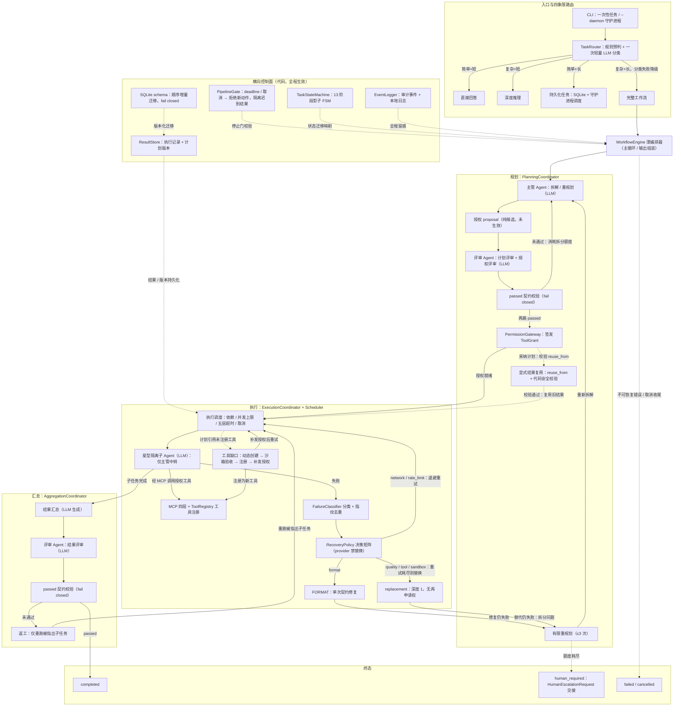

<div align="right">
  <a href="English_README.md">
    
  </a>
</div>

<h1 align="center">SO-Agent</h1>
<p align="center">
  <a href="https://github.com/xiaoyang-student/so-agent/actions/workflows/ci.yml"></a>
  <a href="./LICENSE"></a>
  
</p>
<p align="center">
  <b>受控的多 Agent 执行运行时</b><br>
  <i>LLM 负责思考，代码负责决策。</i>
</p>

受控的多 Agent 执行运行时：基于 [OpenAI Agents SDK](https://github.com/openai/openai-agents-python) 构建的两层星型多 Agent 编排框架。核心设计原则是 **LLM 负责思考，代码负责决策**——LLM 负责理解目标、拆解任务、生成指令与分析内容；状态流转、权限签发、重试控制与执行调度等一切决策均由确定性代码层做出。

> **项目状态：实验性 / 研究用途。** 不适用于生产环境，接口与行为可能随时变化。测试规模与能力声明均为当前代码快照，不构成永久承诺。

- 中文架构文档：[多_Agent_框架.md](./多_Agent_框架.md)
- English architecture document: [SO_Agent_Execution_Runtime.md](./SO_Agent_Execution_Runtime.md)

## 架构总览

下图是当前代码实现形态的总览（仅含已实现能力）：入口经四象限路由分发；完整工作流由薄编排器与规划 / 执行 / 汇总三协调器驱动，覆盖两阶段评审、授权 proposal 到 ToolGrant 的完整生命周期、确定性失败恢复、星型隔离子 Agent、动态工具创建与沙箱验收，以及贯穿全程的横向控制面（停止门、影子状态机、审计事件、ResultStore 与 schema 迁移、人工兜底）。图中实线为任务主流程，虚线为条件路径与横向控制面介入点；暂缓与规划中的方向（多维预算、上下文治理、云沙箱 / microVM、Temporal、ModelGateway 配额治理等）不在图中，详见下文「能力状态与路线图」。



职责边界：LLM（主管 / 评审 / 子 Agent）只负责语义理解、任务拆解（规划）、评审意见与内容生成；任务状态流转、权限签发与撤销、调度、超时、取消、失败恢复策略与最终 `passed` 放行判定全部由确定性代码层做出——评审结论也只有经代码层契约校验（fail closed）后才生效。


## 核心特性（已实现）

以下能力均已在当前代码中实现，并经 **2032 项测试（当前快照）** 覆盖验证：

- **四象限任务路由**：规则预判 + 一次轻量 LLM 分类，按「复杂度 × 时长」将任务分发到直接回答 / 深度推理 / 持久化任务 / 完整工作流四条路径；分类失败时保守降级为完整工作流。
- **两层星型架构**：主管 Agent 独占且仅持有三个工具入口（code_agent、subagent_creator、review_agent）；子 Agent 之间无消息通道、无共享会话，一切通信经主管 Agent 中转。
- **薄编排器 + 三协调器**：WorkflowEngine 只保留主循环与人工兜底，规划（拆解与计划评审）、执行（调度与失败升级）、汇总（聚合与结果评审）分属三个协调器，经共享状态交换信息。
- **13 阶段影子 FSM**：python-statemachine 声明式状态图作为权威任务状态的影子视图，所有合法迁移显式声明，非法迁移被拒绝并留痕。
- **两阶段评审**：计划评审与结果评审均产出结构化 ReviewDecision；`passed` 是唯一放行字段，fail closed——契约无效或解析失败一律保守判定未通过；`suggestions` 为非阻断建议，不构成拒绝理由。
- **结果评审分级与并行**：`result_review_mode` 支持 `always`（默认）/ `risk_based` / `off`；`risk_based` 仅在无验收标准、无写入副作用、无重规划/返工历史且确定性检查覆盖完整时跳过语义评审，并写入 `review_skipped` 审计原因；`result_review_parallel_with_aggregation` 默认开启，让汇总与结果评审并行以降低收尾固定耗时。
- **确定性并行度决策与时间优先**：计划形状由依赖图确定性编译，G1 形状 / G2 独立性（写范围冲突或未声明一律 fail-closed）/ G3 收益前置判定，G4 运行时熔断在 provider 类故障或连续失败达到阈值后把剩余子任务收敛为串行；`optimization_objective=time_first`（默认）用较低的净收益门槛换取更多并行，但要求最小壁钟加速比，避免为微小时间收益消耗大量 token；`token_first` 保留 1.30 严格门槛。实际加速比与门槛随 `parallelism_decided` 事件留痕。
- **简单计划评审跳过**：`skip_plan_review_for_simple` 默认开启，仅在首次计划、子任务不超过 2 个、无依赖、工具均已授权且含写入的子任务具备可机检验收时跳过 LLM 计划评审，并写入 `review_skipped` 审计原因；重规划、含未授权工具或验收规则缺失时一律走完整评审。
- **单文件轻量快通道**：`fast_path_single_file_enabled` 默认关闭；开启后仅对“唯一文本文件纯写入”且无运行/安装/网络/多文件等动作的任务生效：一次轻量模型调用生成正文，控制层做路径包含、符号链接拒绝、原子写入、大小与关键内容校验后直接完成，跳过规划与执行主管调用；任何不确定或失败（空正文、工具标记、缺关键内容、写入失败）都回退完整工作流并写入 `fast_path` 事件，绝不伪造成功。
- **主管工具清单瘦身**：`supervisor_context_slimming` 默认开启，规划载荷中的 `available_tools` 只保留 `name` 与截断到 `supervisor_tool_description_max_chars` 的描述；清单中的工具均已批准且可分配，`source` / `approved` 不参与拆解决策。
- **异步 provisional 交付**：低风险、无外部副作用且确定性检查充分的计划可先交付结果（`completed_provisional`），结果评审在后台继续；评审不通过时自动返工最多 1 次并重新评审，修订结果携带 `previous_result` 保留旧版本，耗尽后转人工；有验收标准、写入副作用或历史失败的任务始终同步阻塞评审，不会先交付后纠正。
- **授权 proposal 后置签发与全出口撤销**：工具授权由代码层在计划评审通过后统一签发（proposal → grant），任务结束、替换、重规划等所有出口均撤销授权。
- **确定性失败恢复**：FailureClassifier 对失败分类（低信任 Agent 文本不能伪造系统失败类别）、失败指纹去重（同因连续失败达阈值即抑制重试）、RecoveryPolicy 按类别给出重试 / 修复 / 替换 / 重规划决策；provider 类故障禁止替换，输出格式（FORMAT）失败仅允许一次契约修复后转入重规划。
- **写入范围确定性验收**：子任务声明 `write_scope`（沙箱内相对路径，支持通配符）；控制层在执行后按文件系统事实校验声明产物是否真实落地，自述成功但文件缺失即翻转为失败并进入既有恢复链路；并行调度的写冲突判定与同一套范围语义。
- **可机检验收规则**：`SubtaskSpec.verification` 支持 `file_exists` / `file_non_empty` / `json_field` / `numeric_match` / `text_contains` / `exit_code`；执行后由代码层确定性求值，任一规则失败即翻转成功标记并写入 `verification_failed` 审计，不依赖模型自述。
- **执行证据后置校验**：code_agent 的 `create` / `modify` 声明文件必须真实存在且非空、`execute` 必须带成功的沙箱执行结果；声明产出文件或产物的成功子任务必须存在本次尝试完成的工具调用证据，否则在返回主管前即翻转为失败。
- **规划阶段工具调用确定性拦截**：主管调用的当前阶段由控制层经上下文注入，planning / replanning 阶段三个固定工具入口在进入 MCP 服务器前一律拒绝（返回 `phase_tool_forbidden` 并写入 `tool_denied` 审计），不再只依赖提示词约束；执行与汇总阶段正常放行。
- **替代链深度 1 与有限重规划**：单 Agent 最多尝试 3 次、原始子 Agent 只能申请一次替代、替代 Agent 无再申请权、主管最多 3 次拆分修订（支持显式 `reuse_from` 复用旧结果），耗尽后进入 `human_required` 人工兜底状态。
- **五层流式超时（默认只保留存活检测）**：首事件 / 模型空闲 / 工具执行三层窗口默认开启，用于识别断流与卡死；单 Agent 总预算与流水线绝对 deadline 默认关闭（`0`），正常任务不会因固定总时长被终止。`PipelineGate` 停止门在显式 deadline 到期或取消后拒绝一切新动作并隔离迟到结果。
- **活动看门狗**：任一 SDK 流事件、工具生命周期、子任务完成、阶段推进或检查点都会续时；只有连续 `pipeline_no_progress_timeout` 秒完全无活动才判定卡死，并由有限重试 / 重规划 / 检查点续跑收口，避免无限循环。
- **工具 timeout profile**：普通工具、嵌套子 Agent、长时代码 Agent 使用独立的工具阶段等待窗口；嵌套/代码 Agent 父级窗口默认关闭，由子 Agent 自身的存活窗口与回合上限负责卡死检测。
- **动态工具生成与 MCP 层**：code_agent 生成工具须提供 test_cases 自证正确，注册前在沙箱中逐用例语义验收；协议层提供 MCP Server / Client / 双向适配器。
- **持久化与 schema 迁移**：SQLite 存储长事务任务、执行记录（Execution）与计划版本（PlanVersion）；版本化顺序增量迁移，幂等、事务化、未知高版本 fail closed。
- **Web 控制台**：`so-agent-web` 提供提问、任务列表、实时状态、完整执行路线图与任务分解依赖图（原生 SVG，支持缩放/平移/节点详情）、执行时间线与产物预览下载；完整执行路线展示路由判断阶段、实际选中分支、每次工具调用、动态 Agent 创建与释放、生成工具生命周期，点击子任务节点可查看对应工具与 Agent 详情；每个 Web 任务使用独立沙箱与上下文。结果同时沉淀为 `results/latest.md` 与 `results/latest.json`（可通过 `/api/results/latest` 获取）；默认不保留历史，新任务提交时清理上一次终态任务与产物，`web_keep_history=true` 时追加 JSONL 历史（`HistoryStore` 接口预留，可替换为其他存储）。
- **Web 安全与重启恢复**：默认仅监听 `127.0.0.1`；绑定非回环地址时强制要求访问令牌，令牌只接受请求头或 HttpOnly Cookie，不接受查询串；HTTPS 下 Cookie 自动加 `Secure`。任务元数据、终态快照与 token 统计持久化到 SQLite，重启后自动恢复；`web_resume_interrupted_tasks=true`（默认）时未完成任务自动重新排队执行，每个任务最多自动恢复 1 次以避免崩溃循环，超出次数与 `human_required` 任务标记失败；终态记录、任务目录与日志按天数与数量双重保留策略清理。SQLite 统一启用 WAL 与 10 秒 busy_timeout（CLI 守护进程与 Web 调度器共享 `task_store.db`；不支持 WAL 的网络盘回退并告警）；Web 启动时对沙箱根目录持有跨平台单实例文件锁（`web.lock`），第二个实例直接拒绝启动，避免双调度器重复执行持久化任务。
- **持久化任务语义与内置调度**：持久化路径创建成功返回真实的 `scheduled` 状态；到期动作经四象限路由执行，涉及文件/命令时自动升级为完整工作流，每个调度任务使用独立子沙箱（`<sandbox>/scheduled/<task_id>`）；`event` 触发因缺少外部事件源而显式失败，不再静默降级为轮询；Web 进程可内置持久化任务调度器（`web_scheduler_enabled`），与 CLI 守护进程共享同一 `task_store.db`。cron 支持任务级 IANA 时区（`ScheduleSpec.timezone`）；错过触发窗口按 `scheduler_misfire_policy` 处理（`coalesce` 补跑一次、`catch_up` 有界补跑、`skip` 跳过），失败按 `scheduler_task_max_retries` 与指数退避重排、耗尽后暂停；每次执行（含跳过）写入 `task_runs`，Web 控制台“定时任务”面板可逐次查看状态、错误与结果摘要。
- **上下文与输出治理**：主管载荷按阶段裁剪并剔除空字段（`prune_empty`），完整载荷逐阶段记录字符数、估算 token 与最大字段（`context_payload_audit`）；向代码/动态子 Agent 注入沙箱浅层文件索引（`artifact_index_in_prompt`）；确定性压缩（不做语义摘要）保护编号、路径、验收规则等关键字段不被截断；工具输出与代码 Agent 回报按上限截断（`tool_output_max_chars` / `code_agent_output_max_chars`），并抑制代码正文与 diff 重复回显（`code_agent_suppress_diff_echo`）。
- **成本与输出治理**：直接回答与深度推理路径支持输出 token 上限（`direct_answer_max_tokens` / `deep_reasoning_max_tokens`，`<=0` 关闭）；任务级 token 预算默认启用（单任务 80 万、单 Agent 40 万双阈值，超限在下一安全检查点直接失败且不重试）；`/api/health` 在未配置令牌（仅回环访问）或携带有效令牌时返回与 `/api/metrics` 同源的运维详情（含兼容字段 `tasks` / `sandbox_backend` / `token_budget`），配置令牌后的未鉴权请求仅返回就绪状态与是否要求鉴权。完整成本/时间多维预算与上下文治理仍暂缓。
- **人工升级通知**：`human_required` 时可选投递安全 Webhook（默认关闭，仅 HTTPS、默认拒绝内网、令牌只读环境变量）；支持有界重试（网络错误 / 429 / 5xx，指数退避）、稳定幂等键与可选 HMAC-SHA256 签名。启用 `notification_outbox_enabled` 后通知先写入独立 SQLite，再由 Web 进程或 CLI 守护进程的后台任务按退避排空，`/api/health` 暴露队列积压与最老等待时长。
- **插件化能力扩展**：沙箱、LLM、MCP、规则、观测五类能力统一为插件目录（`plugins/<kind>/<name>/plugin.yaml`）；仅加载显式启用的外部插件，清单未知字段、未声明权限、明文密钥、API 版本不符、入口越界与摘要不匹配一律拒绝启动。内置实现先登记为插件，外部插件与内置插件同 id 时拒绝覆盖。规范见 `docs/插件化规范.md`。
- **可选编排运行时**：默认 `orchestration_runtime=native` 直接使用现有 `WorkflowEngine`；`langgraph` 为可选外层适配器（任务粒度托管、惰性导入），未安装依赖时启动失败，内核不引入硬依赖。分阶段状态机、人工兜底与检查点语义保持不变。
- **高风险动作审批门**：默认关闭；启用后 `run_in_sandbox` 命中网络、子进程、删除、提权等风险模式时先落盘审批记录（按任务/工具/参数幂等），经 Web 控制台 `GET/POST /api/approvals` 或通知 outbox/Webhook 决定后执行；拒绝、超时或记录异常一律按失败返回，审批记录跨进程保留，Web 重启后可继续查看与决定。说明见 `docs/编排运行时与审批门.md`。
- **中英双语界面**：Web 控制台菜单、状态、提示与 API 错误支持中英切换（`?lang=en`）。

## 安装

要求 Python 3.10+。以下命令均适用于 Windows PowerShell（不使用 `&&` 连接符）。

```powershell
python -m venv .venv
.\.venv\Scripts\python.exe -m pip install -e ".[dev]"
# 需要 Web 控制台时追加 web 依赖
.\.venv\Scripts\python.exe -m pip install -e ".[dev,web]"
# 需要 OpenTelemetry 追踪时追加 otel 依赖
.\.venv\Scripts\python.exe -m pip install -e ".[dev,otel]"
```

## 密钥配置

密钥不写入仓库。两种方式（任选其一）：

1. **环境变量**：为各 Agent 的 `api_key_env` 所指环境变量赋值，例如：

   ```powershell
   $env:SO_AGENT_API_KEY = "sk-your-key"
   ```

2. **secrets.yaml**（项目根目录，已被版本控制忽略）：`main.py` 启动时自动加载其中的键值对到环境变量。

各 Agent 的连接配置位于 `src/so_agent/api_config.yaml` 与 `src/so_agent/tool_packages/<agent>/api_config.yaml`。推荐写法是声明 `api_key_env`（环境变量名）；`api_key` 直接写值仅为兼容保留且不推荐。示例见各级 `api_config.yaml.example`。

配置可选 `fallbacks` 列表后，模型调用经 ModelGateway 按顺序故障转移：连接、超时、429、5xx、认证/权限与模型不存在会切换供应商，400 等请求本身非法的错误直接抛出；连续失败达到 `failover.failure_threshold` 后进入 `cooldown_seconds` 冷却。未配置 `fallbacks` 时客户端与旧行为完全一致。流式调用只在收到首个响应前切换，已开始输出后不重放。

跨任务防篡改审计默认关闭；设置 `SO_AGENT_AUDIT_TRAIL_PATH` 后，所有事件同步追加到独立 SQLite 审计库并按 SHA-256 前向哈希串联。校验命令：

```powershell
$env:SO_AGENT_AUDIT_TRAIL_PATH = "logs/audit.db"
python -m so_agent.audit_cli verify logs/audit.db --json
# 安装为命令行脚本后也可使用：so-agent-audit verify logs/audit.db
```

OpenTelemetry 追踪默认关闭，安装 `otel` 依赖后通过环境变量启用：

```powershell
$env:SO_AGENT_OTEL_ENABLED = "1"
$env:SO_AGENT_OTEL_EXPORTER = "otlp"   # none / console / otlp
$env:OTEL_EXPORTER_OTLP_ENDPOINT = "http://127.0.0.1:4318"
python -m so_agent.main "用一句话解释二分查找的时间复杂度"
```

启用后为工作流、分类、子任务、直接回答 / 深度推理 / 调度解析与模型调用创建 span；`otel_exporter=none` 时沿用宿主已配置的全局 TracerProvider，`console` 直接输出到标准错误，`otlp` 读取标准 `OTEL_EXPORTER_OTLP_*` 变量。追踪初始化或导出失败只降级为 no-op，不影响任务执行。

## 快速开始

```powershell
# 一次性任务（任务目标也可从标准输入管道读取）
.\.venv\Scripts\python.exe -m so_agent.main "为目标目录实现一个 CLI 统计工具" --constraints "仅使用标准库" --acceptance-criteria "提供可运行脚本并自我验证"

# 持久化任务调度守护进程（后台轮询并执行到期任务，无需任务目标）
.\.venv\Scripts\python.exe -m so_agent.main --daemon

# Web 控制台（浏览器打开 http://127.0.0.1:8765/）
.\.venv\Scripts\python.exe -m so_agent.web.app
```

说明：

- `--config <文件>` 可用 YAML / JSON 覆盖 `Settings` 默认字段（如 `max_concurrency`、`model_timeout`）；
- Web 控制台参数：`--host`（默认 `127.0.0.1`）、`--port`（默认 `8765`）、`--sandbox`（任务沙箱根目录）、`--config`、`--token`（访问令牌；也可用环境变量 `SO_AGENT_WEB_AUTH_TOKEN`）；绑定非回环地址时未配置令牌会直接启动失败；
- 任务终态为 `completed` 或持久化任务创建成功（`scheduled`）时退出码为 0，其余终态（`human_required` / `failed` / `cancelled`）为 1，参数或配置错误为 2；
- 标准输出仅打印结构化 JSON 结果，运行状态摘要打印到标准错误。

### 沙箱准备（Windows 10/11 / Linux / macOS）

默认 `sandbox_backend=auto`：检测到 Docker/Podman 时使用容器隔离；否则回退到本地验证型沙箱并记录警告。生产或运行不可信代码时应显式要求隔离：

```powershell
# Windows 10 (2004+) / Windows 11：检测并引导安装 Docker Desktop 或 Podman
powershell -ExecutionPolicy Bypass -File scripts/sandbox_setup.ps1 -WriteEnv
# 安装运行时并启动后，执行隔离自检
python -m so_agent.sandbox_cli selftest
```

```bash
# Linux / macOS
sh scripts/sandbox_setup.sh --write-env
python -m so_agent.sandbox_cli selftest
```

常用命令：

- `so-agent-sandbox doctor [--json] [--require-isolation]`：只读体检，输出平台、配置/解析后端、镜像与探测结果；
- `so-agent-sandbox selftest [--backend docker|podman|local]`：真实执行探针，检查工作目录外读写、外网访问与宿主密钥泄漏；任一逃逸成功即判定未通过；
- `so-agent-sandbox setup [--pull-image] [--write-env FILE]`：检测运行时、校验镜像，并仅向 `.env` 追加缺失键。

强制隔离配置（未满足时启动/构造沙箱直接失败，不会静默回退）：

```dotenv
SO_AGENT_SANDBOX_BACKEND=auto
SO_AGENT_SANDBOX_REQUIRE_ISOLATION=true
SO_AGENT_SANDBOX_CONTAINER_IMAGE=python:3.12-slim
```

容器后端默认 `--network none`、只读根文件系统、`--cap-drop ALL`、`no-new-privileges`、pids/内存/CPU 限制，且仅挂载本次运行目录；它不等同于 microVM，云沙箱通过 `register_sandbox_backend("cloud", factory)` 预留接入。

## 运行测试

```powershell
.\.venv\Scripts\python.exe -m pytest
```

当前收集 **2032 项测试（当前快照）**，默认全部使用假模型，不消耗真实 API；真实端到端测试需提供密钥后单独执行。

### 固定质量回归集与指令遵循评分

`tests/baseline/quality_cases.json` 固定 14 个业务问题（直接问答 / 深度推理 / 单文件 / 多文件 / 指令遵循五类）。每条用例声明：

- 必须出现的关键值（`contains` / `contains_any` / `regex`）与禁止出现的错误结论（`not_contains`）；
- 指令遵循约束：句数上限、语言、仅输出 JSON 或仅输出指定格式；
- 沙箱产物检查：文件存在、必须包含/禁止包含的文本与最小字节数。

`scripts/quality_regression.py` 评分完全确定性（加权检查，无模型打分），三种模式：

```powershell
# 仅校验用例文件
python scripts/quality_regression.py --dry-run
# 回放已录制输出（<id>.txt + <id>/ 产物目录），不调用模型
python scripts/quality_regression.py --recorded sandbox/quality-recorded
# 真实 LLM 执行（可 --category / --case 过滤），证据默认写入 sandbox/quality_evidence.json
python scripts/quality_regression.py --category instruction_following
```

任一条用例未通过时进程退出码为 1，可直接用于 CI，或在每次优化前后复跑同一集合，验证“省 token 但准确性可控”。

## CI 与容器部署

- **CI**：`.github/workflows/ci.yml` 在 Ubuntu / Windows / macOS 三平台、Python 3.10 与 3.13 上执行安装、字节码编译、沙箱 doctor、全量测试与 wheel 构建；依赖通过 `constraints.txt` 固定已验证版本。仓库已接入 GitHub Actions。
- **容器**：`Dockerfile` 以非 root 用户运行 Web 控制台，`docker-compose.yml` 对本机回环端口映射并强制要求 `SO_AGENT_API_KEY` 与 `SO_AGENT_WEB_AUTH_TOKEN`。容器内没有嵌套容器运行时，因此代码沙箱固定为 `local`（仅路径隔离，不是安全边界）；需要容器级代码隔离时应在宿主机运行并使用 `sandbox_backend=docker/podman`。

```bash
# 容器方式启动（两项密钥必须提供）
export SO_AGENT_API_KEY=... SO_AGENT_WEB_AUTH_TOKEN=...
docker compose up -d --build
docker compose cp so-agent-web:/app/results/latest.md ./latest.md
```

## 主要默认配置（当前代码实测）

以下均为运行时间上限与治理参数，可经环境变量（前缀 `SO_AGENT_`）、`.env` 或 `--config` 文件覆盖。它们**不是**已实现的多维预算体系（预算与上下文治理当前暂缓，见下文）。

| 参数 | 默认值 | 说明 |
| --- | --- | --- |
| `max_model_turns` | 8 | 单次 Agent 运行最大模型回合数 |
| `model_timeout` | 45 秒 | 单次模型调用超时（HTTP 层） |
| `first_event_timeout` | 180 秒 | 流式首事件窗口 |
| `model_idle_timeout` | 90 秒 | 模型阶段空闲窗口 |
| `tool_execution_timeout` | 180 秒 | 普通工具执行窗口 |
| `subagent_tool_execution_timeout` | 0（关闭） | 嵌套子 Agent 父级工具窗口；`0` 表示不设父级硬截止（显式设置为正数时，未显式派生则取 Agent 总预算 + 10 秒） |
| `code_agent_tool_execution_timeout` | 0（关闭） | 代码 Agent 父级工具窗口（同上语义） |
| `agent_total_timeout` | 0（关闭） | 单次 Agent 调用总预算；`0` 表示不限，长任务可持续任意时长 |
| `supervisor_total_timeout` | 0（关闭） | 主管单次调用总预算；`0` 表示不限 |
| `pipeline_no_progress_timeout` | 1200 秒 | 活动看门狗：连续该秒数完全没有活动才判定停滞（主控手段，`<=0` 关闭） |
| `max_pipeline_timeout` | 0（关闭） | 流水线绝对兜底上限；仅部署方显式开启时生效（`<=0` 不设上限） |
| `grant_ttl_seconds` | 86400 秒 | 工具授权默认有效期，与任务总时长解耦（`<=0` 表示不过期，任务退出时仍统一撤销） |
| `review_parse_retry_max_attempts` | 1 | 评审输出无法解析时的严格契约重试次数（`0` 表示直接 fail-closed） |
| `result_review_mode` | `always` | 结果评审模式：`always` / `risk_based`（低风险且确定性检查充分时跳过并记录原因）/ `off`（仅确定性验收） |
| `result_review_parallel_with_aggregation` | `true` | 汇总与结果评审并行执行 |
| `skip_plan_review_for_simple` | `true` | 简单首次计划（≤2 子任务、无依赖、工具已授权、写入验收可机检）跳过 LLM 计划评审并记录原因 |
| `skip_result_review_for_simple` | `true` | 简单任务快速通道（跳过汇总与结果评审） |
| `fast_path_single_file_enabled` | `false` | 单文件纯写入快通道（一次模型调用 + 确定性写入校验；不匹配或失败回退完整工作流） |
| `fast_path_max_output_tokens` | 2048 | 快通道单次模型输出上限（`<=0` 不限制） |
| `fast_path_max_file_bytes` | 262144 | 快通道允许写入的单文件字节上限（`<=0` 不限制） |
| `supervisor_context_slimming` | `true` | 规划载荷工具清单只保留名称与截断描述，去掉 `source` / `approved` |
| `supervisor_tool_description_max_chars` | 160 | 工具描述截断上限（`<=0` 不截断） |
| `result_review_async_provisional` | `false` | 异步 provisional 交付：低风险无副作用任务先交付、后台评审并自动返工最多 1 次 |
| `code_agent_postcondition_enabled` | `true` | code_agent 后置校验：create/modify 文件须真实存在且非空、execute 须有成功沙箱结果 |
| `subtask_tool_evidence_required` | `true` | 声明产出的成功子任务必须存在本次尝试完成的工具调用证据 |
| `context_payload_audit` | `true` | 逐阶段记录主管载荷字符数、估算 token 与最大字段 |
| `artifact_index_in_prompt` | `true` | 向代码/动态子 Agent 注入沙箱浅层文件索引（仅元数据） |
| `context_compression_enabled` | `true` | 确定性上下文压缩开关（不做语义摘要） |
| `context_compression_max_chars` | 24000 | 单次载荷压缩后的总字符上限 |
| `context_compression_result_chars` | 4000 | 单条执行结果保留字符上限 |
| `context_compression_protect_critical` | `true` | 编号/契约枚举/路径/验收规则等关键字段不参与压缩 |
| `code_agent_suppress_diff_echo` | `true` | 抑制代码正文与 diff 重复回显，diff 只保留路径/行数/字节数摘要 |
| `code_agent_max_output_tokens` | 0（不限制） | code_agent 输出 token 上限 |
| `tool_output_max_chars` | 12000 | 工具返回 JSON 中单个字符串字段的截断上限（`<=0` 不截断） |
| `code_agent_output_max_chars` | 8000 | 代码 Agent 嵌套回报的截断上限（`<=0` 不截断） |
| `max_dynamic_agents` | 8 | 动态子 Agent 数量上限 |
| `max_concurrency` | 3 | 并发执行子任务数上限 |
| `optimization_objective` | `time_first` | 多 Agent 效率目标：`time_first` 时间优先 / `token_first` token 优先 |
| `parallelism_net_gain_threshold` | 0（按目标） | 并行净收益门槛；`<=0` 时 time_first 用 1.10、token_first 用 1.30 |
| `parallelism_min_speedup` | 0（按目标） | 并行最小壁钟加速比；`<=0` 时 time_first 用 1.10、token_first 用 1.00，低于门槛直接串行 |
| `max_agent_attempts` | 3 | 单 Agent 尝试次数上限（真实次数由恢复策略决定） |
| `audit_trail_path` | 空（关闭） | 跨任务防篡改审计链的 SQLite 路径；设置后每条事件同步写入哈希链 |
| `otel_enabled` | `false` | OpenTelemetry 追踪开关；未安装依赖或初始化失败时静默降级为 no-op |
| `otel_service_name` | `so-agent` | 追踪资源中的 `service.name` |
| `otel_exporter` | `none` | 导出方式：`none`（沿用宿主全局 provider）/ `console` / `otlp` |
| `max_replacement_requests` | 1 | 替代申请次数上限（替代链深度 1） |
| `max_replan_attempts` | 3 | 主管拆分修订次数上限 |
| `sandbox_timeout` | 300 秒 | 沙箱单次命令超时（`<=0` 不限制） |
| `sandbox_output_limit` | 1 MiB | 沙箱输出上限 |
| `sandbox_backend` | `auto` | 沙箱后端：`auto` / `docker` / `podman` / `local` / `cloud`（未注册实现时失败关闭） |
| `sandbox_allow_local_fallback` | `true` | `auto` 未检测到容器时是否允许回退本地验证沙箱 |
| `sandbox_require_isolation` | `false` | 强制容器隔离；为 `true` 且无容器时拒绝回退 |
| `sandbox_container_image` | `python:3.12-slim` | 容器沙箱镜像 |
| `sandbox_container_network` | `none` | 容器网络：`none`（默认）/ `bridge` |
| `sandbox_container_memory_mb` | 512 | 容器内存上限（MB） |
| `sandbox_container_cpus` | 1.0 | 容器 CPU 配额 |
| `sandbox_container_pids_limit` | 128 | 容器进程数上限 |
| `sandbox_container_tmpfs_mb` | 64 | 容器 `/tmp` 大小（noexec/nosuid） |
| `sandbox_container_pull` | `true` | 镜像缺失时是否自动拉取 |
| `sandbox_cloud_*` | 空 | 云沙箱预留参数（provider / endpoint / api_key_env / template / timeout） |
| `plugins_dir` | `plugins` | 插件根目录（相对当前工作目录） |
| `plugins_enabled` | 空 | 逗号分隔插件 id；空=仅内置，`*`=加载全部 |
| `plugins_require_hash` | `false` | 强制外部插件入口文件 SHA-256 钉住 |
| `orchestration_runtime` | `native` | 编排运行时：`native` / `langgraph`（可选依赖，缺失时启动失败） |
| `high_risk_approval_enabled` | `false` | 高风险工具调用审批门开关 |
| `high_risk_approval_timeout_seconds` | 300 | 审批等待上限；超时按拒绝处理 |
| `high_risk_approval_poll_seconds` | 1.0 | 等待期间轮询审批记录的间隔 |
| `high_risk_approval_patterns` | 空 | 追加风险正则（分号分隔，命中即需审批） |
| `approval_store_path` | 空 | 审批记录 SQLite 路径；空时位于共享存储目录 |
| `scheduler_poll_interval` | 60 秒 | 守护进程轮询间隔 |
| `scheduler_misfire_policy` | `coalesce` | 错过触发窗口策略：`coalesce` / `catch_up` / `skip` |
| `scheduler_misfire_grace_seconds` | 60 | 超过该宽限才视为“错过”（秒） |
| `scheduler_max_catch_up_runs` | 3 | `catch_up` 单轮最多补跑次数 |
| `scheduler_task_max_retries` | 0 | 单任务失败重试次数（0=失败即暂停） |
| `scheduler_task_retry_backoff_seconds` | 60.0 | 失败重试指数退避基数（秒，单次上限 3600） |
| `task_store_path` | `sandbox/task_store.db` | SQLite 任务存储路径 |
| `generated_tools_dir` | `generated_tools` | 生成工具目录（相对路径以 `sandbox_dir` 为根） |
| `web_max_concurrent_tasks` | 2 | Web 控制台同时执行的任务上限（超出排队） |
| `web_auth_token` | 空 | Web 访问令牌；为空时仅允许回环地址绑定 |
| `web_sandbox_dir` | `sandbox/web` | Web 任务沙箱根目录（相对路径以当前工作目录为根） |
| `web_task_retention_days` | 7 | 终态任务记录、任务目录与日志保留天数（`<=0` 关闭按时间清理） |
| `web_max_retained_tasks` | 200 | 保留的终态任务记录上限（`<=0` 关闭按数量清理） |
| `web_scheduler_enabled` | `true` | 是否在 Web 进程内运行持久化任务调度器 |
| `web_resume_interrupted_tasks` | `true` | 重启后自动重跑未完成任务；每个任务最多自动恢复 1 次，之后标记失败 |
| `web_keep_history` | `false` | 是否保留跨任务结果历史；默认仅保留最近一次 |
| `web_results_dir` | `results` | 结果沉淀目录（相对 Web 任务根目录，写入 `latest.md` / `latest.json`） |
| `direct_answer_max_tokens` | 1024 | 直接回答路径输出 token 上限（`<=0` 不限制） |
| `deep_reasoning_max_tokens` | 4096 | 深度推理路径输出 token 上限（`<=0` 不限制） |
| `token_budget_enabled` | `true` | 任务级 token 预算熔断开关；关闭后只累计不拦截 |
| `token_budget_max_total_tokens` | 800000 | 单任务总 token 上限（`<=0` 不限制该维度） |
| `token_budget_max_agent_tokens` | 400000 | 单 Agent 累计 token 上限（`<=0` 不限制该维度） |
| `escalation_webhook_url` | 空 | 人工升级通知 Webhook（默认关闭，仅 HTTPS） |
| `escalation_webhook_token_env` | 空 | 通知 Bearer 令牌所在环境变量名（缺失时失败关闭） |
| `escalation_webhook_max_attempts` | 3 | 通知总尝试次数（含首次；`1` 表示不重试） |
| `escalation_webhook_retry_backoff_seconds` | 0.5 | 重试指数退避基数（秒） |
| `escalation_webhook_signing_secret_env` | 空 | 可选 HMAC-SHA256 签名密钥环境变量名 |
| `notification_outbox_enabled` | `false` | 通知持久化 outbox 开关；启用后先落 SQLite 再投递 |
| `notification_outbox_path` | `sandbox/notification_outbox.db` | outbox SQLite 路径 |
| `notification_outbox_max_attempts` | 8 | 单条通知最大投递次数（含首次） |
| `notification_outbox_retry_backoff_seconds` | 5.0 | 后台重试退避基数（秒，单次上限 300） |
| `notification_outbox_drain_interval_seconds` | 30.0 | 后台排空间隔（秒） |
| `notification_outbox_batch_size` | 20 | 单轮最多处理的到期通知数 |

## 能力状态与路线图

严格区分实现状态，避免把愿景写成现有能力。

### 已实现

四象限路由、薄 WorkflowEngine 与三协调器、13 阶段影子 FSM、两阶段评审（`passed` 唯一放行 + fail closed）、结果评审分级（`always` / `risk_based` / `off`）与汇总并行评审、可机检验收规则、code_agent 后置校验与子任务工具证据、低风险异步 provisional 交付与自动返工纠正、逐阶段载荷瘦身与审计、产物索引注入、保护关键字段的确定性压缩、输出治理（截断与 diff 去重）、授权 proposal 后置签发与全出口撤销、星型通信隔离、显式 `reuse_from` 复用、五层流式超时、PipelineGate、工具 timeout profile、schema migration、FailureClassifier、失败指纹与去重、RecoveryPolicy、provider 禁替代、FORMAT 单次受限契约修复后 REPLAN、低信任 Agent 文本不可伪造系统失败、SQLite 持久化（任务 / Execution / PlanVersion）、可插拔沙箱后端（`auto` / Docker / Podman 容器隔离、本地验证沙箱、云后端预留）与隔离自检 CLI、MCP 协议层、动态工具语义验收注册、Web 任务元数据持久化与保留清理、Web 结果沉淀（`latest.md` / `latest.json`、默认单任务覆盖、可插拔历史接口）、Web 内置持久化调度、持久化任务 `scheduled` 状态、调度时区与错过策略（补跑 / 跳过）、单任务失败退避重试、逐次运行历史与 Web 定时任务面板、输出 token 上限、任务级 token 双阈值预算熔断、人工升级 Webhook（重试 / 幂等键 / HMAC 签名）与可选持久化 outbox（跨进程重试、队列健康指标）、Web 中英双语、三平台 GitHub Actions CI、经验证版本约束（`constraints.txt`）、非 root 容器镜像与 compose 部署骨架、SQLite WAL 与 Web 单实例文件锁、ModelGateway 多供应商故障转移（可选 `fallbacks` + 冷却熔断，覆盖 Agent 模型与直连调用）、跨任务防篡改审计链（可选独立 SQLite、SHA-256 前向哈希与 `so-agent-audit verify`）、可选 OpenTelemetry 追踪（工作流 / 分类 / 子任务 / 路径与模型调用 span，默认关闭且失败降级为 no-op）。

### 暂缓（设计理念保留）

- **多维预算**：token / 成本 / 时间的多维度预算体系。任务级 token 双阈值（总量与单 Agent）已默认启用并可熔断；成本、时间等其余维度以及跨任务配额仍属规划，不等于完整多维预算。
- **上下文治理**：长任务的上下文压缩、裁剪与配额管理。
- **云沙箱 / microVM**：本地容器后端（Docker/Podman）已内置，提供命名空间、cgroup 与 capability 级隔离；云沙箱、microVM 与硬件级隔离仍属规划，`cloud` 后端名与配置参数已预留，未注册实现前构造即失败关闭。

### 规划中（未实现）

- **ModelGateway 配额治理**：多供应商故障转移已实现；按供应商的配额、成本分摊与跨任务配额仍未实现。
- **权限执行级与参数级强化**：现有授权为工具名粒度；按参数细粒度约束的强化尚未实施。
- **Temporal PoC 或迁移**：以 Temporal 替代进程内编排的可行性验证。
- **审计链查询与外部锚点**：可选哈希链与 `verify` 已实现；跨任务查询 API、检测尾部截断所需的外部锚点与容量保留策略仍未实现。
- 其他保留的未来方向：工具 TTL 缓存与调用计数驱动的持久化阈值（原 Redis 设想，现行以显式持久化调度替代）、统计数据库分析表（原 MySQL 设想，现行以 SQLite 执行记录与本地日志替代）、动态 Agent 模板与能力白名单。

## 风险与限制

- **实验或研究状态**：本项目的治理与恢复机制面向研究与验证，未经生产负载检验。
- **底层流式取消可能延迟**：超时或取消收尾依赖底层 SDK 的取消行为；关闭迭代器有有限宽限，极端情况下底层取消可能延迟，迟到结果由停止门隔离但不保证资源即时释放。
- **沙箱隔离取决于后端**：默认 `auto` 在检测到 Docker/Podman 时使用容器隔离（无网络、只读根、capability 全量丢弃、资源限制）；未检测到运行时且允许回退时使用本地验证沙箱（SandboxRunner），它只做工作目录路径隔离与环境变量脱敏，**不是安全边界，不能安全运行不可信代码**。生产或不可信代码场景应设置 `sandbox_require_isolation=true`，并先用 `so-agent-sandbox selftest` 验证隔离；容器与宿主共享内核，不等同于 microVM。
- **人工兜底通知仍是尽力而为**：`human_required` 终态会产出完整的 HumanEscalationRequest 交接数据，并可选择投递外部 Webhook；通知失败只记录、不阻断任务，且不包含人工工作台或工单回写系统。启用 outbox 后失败通知会持久化并由 Web / CLI 守护进程后台重试（至少一次语义，接收方需按幂等键去重），但一次性 CLI 进程退出后不再排空。
- **模型故障转移有边界**：仅在首个流式响应前切换供应商；已输出内容后失败不会重放，交由既有恢复策略处理。不同供应商的模型能力、上下文窗口与工具调用格式可能不同，备选模型应由部署者自行验证；连接失败但供应商已产生计费的情况无法避免。
- **审计链有边界**：默认关闭；启用后每条事件同步写入独立 SQLite 并按哈希串联，可发现中间记录被修改、重排或删除，但无法发现尾部整体截断（没有外部锚点）。审计库只追加不裁剪，容量与备份由部署方负责；写入失败只告警、不阻断任务。
- **追踪有边界**：OpenTelemetry 默认关闭，需显式安装依赖并设置 `otel_enabled`；span 只记录任务规模、类型、状态与模型名等非敏感属性，不包含提示词、模型输出或密钥。导出失败只降级为 no-op，不提供采样、跨进程传播或指标 / 日志信号的统一接入。
- **预算与上下文暂缓**：任务级 token 预算已默认启用（800k / 400k 双阈值，超限失败不重试）；成本/时间等多维预算与上下文治理仍暂缓，长任务的其余成本控制依赖时间上限、有限重试额度与单路径输出 token 上限。

## 文档

- [多_Agent_框架.md](./多_Agent_框架.md)：中文架构文档——原始总体设计思想与实际演进、分层、状态模型、数据结构、权限、配置与测试计划。
- [SO_Agent_Execution_Runtime.md](./SO_Agent_Execution_Runtime.md)：English architecture document（与中文版章节和能力状态一一对应）。
- [docs/基准与稳定性报告.md](./docs/基准与稳定性报告.md)：真实 LLM 的 token / 耗时 / 重试基线，以及与原生 API、网页端的同题对比（历史测量记录）。
- [docs/改造路线.md](./docs/改造路线.md)：1.4 改造的验收口径、分阶段步骤、逐文件清单与执行记录。
- [docs/生产化重构设计.md](./docs/生产化重构设计.md)：生产化目标形态、模块拆分、开源选型与迁移路线（部分已实施）。
- [docs/插件化规范.md](./docs/插件化规范.md)：插件契约与沙箱、LLM、MCP、规则、观测五类能力的接入方式。
- [docs/编排运行时与审批门.md](./docs/编排运行时与审批门.md)：编排运行时选择与工具调用前的高风险动作审批门。
- 配置示例：[src/so_agent/api_config.yaml.example](./src/so_agent/api_config.yaml.example) 及 `src/so_agent/tool_packages/<agent>/api_config.yaml.example`。
