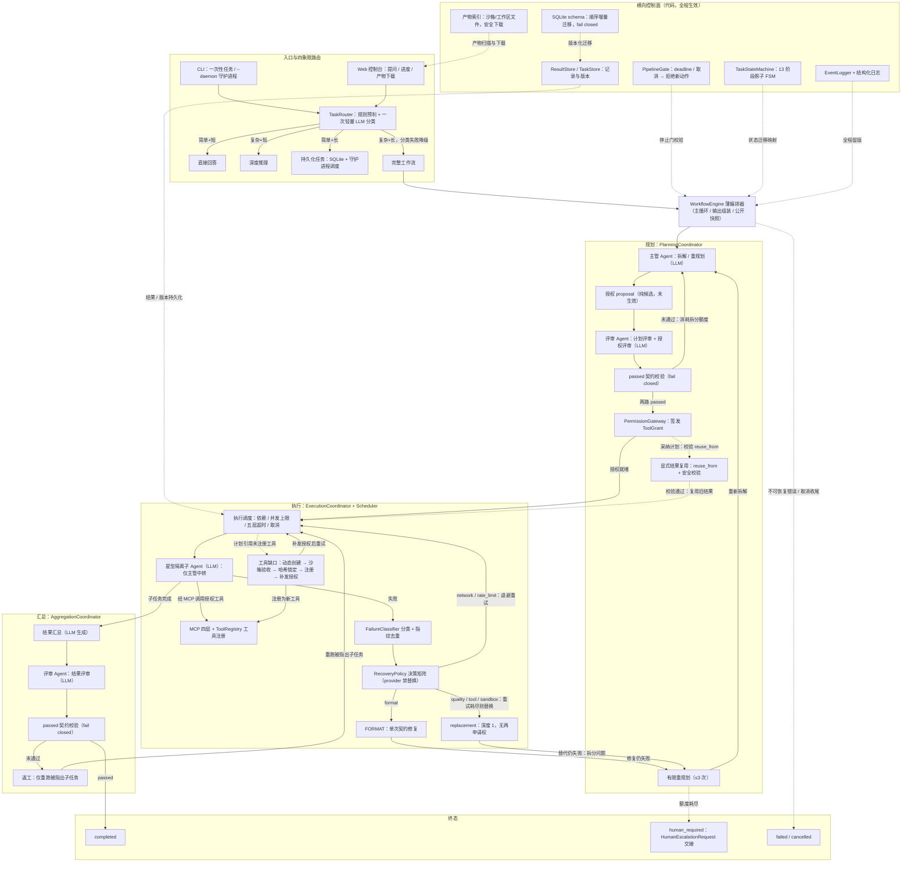
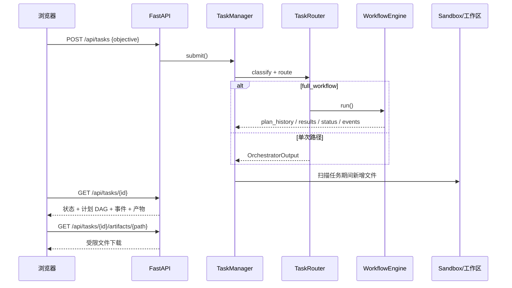
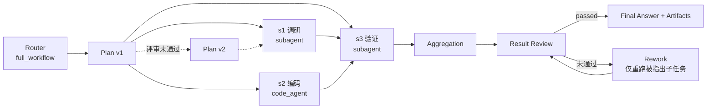

# SO-Agent 1.4 改造路线

> 状态：本轮改造已执行完毕，本文保留为执行记录；当前能力、默认值与测试规模以 [README](../README.md) 和架构文档为准。

> 目标：在**不牺牲安全与稳定**的前提下修复缺陷、收敛过度设计、提升执行效率，并交付一个可提问、可查看问题分解路线、可下载产物的本地 Web 控制台。
>
> 原则：安全 > 稳定 > 效率。任何“提速”改动不得削弱评审放行、授权校验、沙箱边界与审计留痕。

---

## 0. 验收口径

### 0.1 完成定义

1. 干净检出后 `python -m pytest` 全绿（改造前基线为 1209 项：1190 passed / 19 failed）。
2. 下列已确认缺陷全部有代码修复与回归测试：
   - 测试依赖未入库的 `api_config.yaml`；
   - `task_store_path` 默认值被重复拼接 `sandbox/sandbox/...`；
   - cron 仅按固定 24 小时近似；
   - 生成工具源码写入包目录；
   - 暂停任务保持到期状态导致重试风暴；
   - 运行期零 `logging`、44 处 `print`；
   - 已废弃函数壳残留。
3. 新增 Web 控制台：
   - 可提交问题，展示路由、计划版本、子任务 DAG、事件时间线、最终答案与产物下载；
   - 文件下载严格限制在沙箱/工作区内；
   - 默认仅监听 `127.0.0.1`。
4. 使用**真实 LLM**完成至少三条端到端验收：
   - 简单问答（direct_answer）；
   - 完整工作流（full_workflow，含子 Agent 与工具）；
   - 一个会产出文件的编码任务（可在 Web 下载产物）。
5. 安全底线不回退：
   - 评审 `passed` 唯一放行；
   - `ToolGrant` 全出口幂等撤销；
   - provider 类失败禁止替换；
   - 沙箱仍明确声明“非安全边界”，不把不可信代码当安全隔离运行。

### 0.2 非目标（本轮不做）

- 不引入容器级沙箱（Docker / 远程执行）；
- 不实现成本/时间等多维预算与上下文治理（任务级 token 双阈值预算已启用）；
- 不引入 Temporal / 消息队列；
- 不改写 13 阶段影子 FSM 的权威语义（权威状态仍是 `TaskStatus`）。

---

## 1. 现状体检

### 1.1 已确认缺陷

| ID | 严重度 | 证据 | 影响 | 修复方向 |
|---|---|---|---|---|
| D1 | P0 | 全量测试 `1190 passed / 19 failed`；仓库仅存在 `api_config.yaml.example`，真实配置被 `.gitignore` 忽略 | 干净检出无法全绿，测试门禁不可信 | 配置路径支持 `SO_AGENT_API_CONFIG` 覆盖；测试使用临时配置夹具 |
| D2 | P1 | [config.py:128](../../src/so_agent/config.py#L128) 默认 `sandbox/task_store.db`，[main.py:249](../../src/so_agent/main.py#L249) 与 [persistent_task.py:91](../../src/so_agent/paths/persistent_task.py#L91) 又拼 `sandbox_dir` | 实际落到 `sandbox/sandbox/task_store.db`，与文档不符，数据分散 | 默认改为 `task_store.db`，统一相对 `sandbox_dir` 解析；兼容迁移旧库 |
| D3 | P1 | [task_scheduler.py:37](../../src/so_agent/task_scheduler.py#L37) cron 固定 +24h | “每天 9 点”实际在首次执行后 24h 触发 | 实现 5 字段 cron 解析与下次触发计算；非法表达式拒绝落库 |
| D4 | P1 | [code_agent/agent.py:81](../../src/so_agent/tool_packages/code_agent/agent.py#L81)、[:445](../../src/so_agent/tool_packages/code_agent/agent.py#L445) 把生成工具写入包目录 | 只读 `site-packages` 写入失败；动态代码污染包目录；升级/卸载不可控 | 迁移到工作区 `generated_tools/`；包内目录仅保留示例 |
| D5 | P1 | [persistence.py:199](../../src/so_agent/persistence.py#L199) 把 `paused` 当作到期任务；[task_scheduler.py:127](../../src/so_agent/task_scheduler.py#L127) 失败后置 paused 但不清 `next_run_at` | 失败任务每轮询立即重跑，形成重试风暴 | 暂停时清空 `next_run_at`；到期查询仅取 `scheduled` |
| D6 | P1 | 运行期 0 处 `logging`，44 处 `print` | 无结构化日志、无法按 task_id 过滤、生产排障困难 | 引入标准库 logging；保留 CLI stdout JSON 契约 |
| D7 | P2 | [state_machine.py:440](../../src/so_agent/state_machine.py#L440) `_detect_passage_from_text` 已废弃 | 死代码误导维护者 | 直接删除 |
| D8 | P2 | 路由/路径在缺少配置时抛 `ConfigLoadError`，CLI 未兜底 | 用户看到 traceback 而非明确退出码 | CLI 捕获配置错误并返回 2；Web 显示配置未就绪 |
| D9 | P2 | [task_scheduler.py:72](../../src/so_agent/task_scheduler.py#L72) 对每个到期任务无限 `create_task` | 大量到期任务时并发失控 | 引入并发信号量并跟踪在飞任务 |
| D10 | P2 | 生成工具仅按 `entry_file` 加载，无内容完整性校验 | 审批后源码被替换仍会执行 | manifest 增加 `content_hash`；注册与执行前校验 |
| D11 | P2 | `task_scheduler` / 各路径重复构造 `AsyncOpenAI` 客户端 | 超时、重试、密钥逻辑修改需同步 4 处 | 抽公共 helper（不改变可 monkeypatch 点） |
| D12 | P3 | 150 处“任务 N”注释、复述式注释 | 注释与外部台账耦合，易腐化 | 新增注释规范；改造触达文件时同步清理 |

### 1.2 过度设计评估

| 设计 | 判断 | 处理策略 |
|---|---|---|
| `WorkflowEngine` 的 Facade：`_WorkflowStateField` + `_FACADE_METHOD_ROUTES` + `__getattr__`，`BaseCoordinator` 属性代理 | **过度设计**。为保留旧私有属性/方法而增加两层间接，IDE 跳转与静态分析退化 | 本轮不立即拆除（测试引用面大）；先冻结，不再新增路由；后续以公开快照接口替代 |
| 13 阶段影子 FSM | **部分合理**。不参与放行决策，但与 `TaskStatus` 重复 | 保留审计价值；明确“映射而非权威”，禁止继续扩张阶段 |
| 五层超时 + 工具 timeout profile | **合理**。解决流式卡死、嵌套子 Agent 误杀等真实问题 | 保留，只补文档与测试 |
| 内部三工具全部走 MCP | **偏重但合理**。统一注册、发现、超时 profile 与审计 | 保留；不为了“少一层”破坏统一治理 |
| `AgentRegistry` + `ToolRegistry` + `SupervisorRouter` | **合理**。分别治理 Agent 生命周期、工具授权与消息边界 | 保留 |
| `HumanEscalationHandler` 仅记录 | **脚手架，不是过度设计** | 文档继续明确“仅状态出口” |
| `direct_answer` / `deep_reasoning` / `persistent_task` / `task_scheduler` 各自建客户端 | **重复代码，不是过度设计** | 抽 helper，保留模块级 `AsyncOpenAI` 可 patch 点 |

---

## 2. 目标架构

### 2.1 运行时全链路



### 2.2 Web 请求链路



### 2.3 问题分解路线（Web 渲染结构）



Web 端不依赖 CDN：使用原生 SVG 渲染分层 DAG（节点、依赖边、箭头、状态色、缩放/拖拽），保证离线可用。

---

## 3. 分阶段改造步骤

### 阶段 0：基线固定与测试自包含

**步骤 0.1 记录基线**

```bash
python -m pytest -q
```

记录 `1190 passed / 19 failed`，确认 19 个失败均来自缺失 `api_config.yaml`。

**步骤 0.2 配置路径覆盖（新增能力，不破坏默认）**

- 在 [config_loader.py](../../src/so_agent/runtime/config_loader.py) 增加：

```python
def resolve_api_config_path(default: str | Path) -> Path:
    override = os.environ.get("SO_AGENT_API_CONFIG")
    return Path(override).expanduser() if override else Path(default)
```

- 所有 `load_agent_api_config(API_CONFIG_PATH, ...)` 改为
  `load_agent_api_config(resolve_api_config_path(API_CONFIG_PATH), ...)`：
  - [router.py](../../src/so_agent/router.py)
  - [orchestrator.py](../../src/so_agent/orchestrator.py)
  - `paths/direct_answer.py` / `paths/deep_reasoning.py` / `paths/persistent_task.py`
  - `task_scheduler.py`
  - 三个工具包的 `create_*_agent` / `get_mcp_server`
- 保留模块级 `API_CONFIG_PATH` 与 `AsyncOpenAI`，确保既有 monkeypatch 测试继续有效。
- 不设置该环境变量时行为完全不变。

**步骤 0.3 测试夹具**

- 新增 `tests/conftest.py`：

```python
@pytest.fixture
def example_api_config(tmp_path):
    path = tmp_path / "api_config.yaml"
    path.write_text(
        "provider: test\nmodel: fake-model\napi_key_env: SO_AGENT_API_KEY\n",
        encoding="utf-8",
    )
    return path
```

- `tests/unit/test_package_structure.py`：
  - 配置测试改为校验随包分发的 `api_config.yaml.example`；
  - 真实本地配置存在时追加校验，不存在则 skip；
  - `API_CONFIG_PATH` 只断言“位于包目录内”，不再断言文件存在。
- `tests/unit/test_config_loader.py::TestRealProjectConfigs`：
  - 用 `tmp_path` 构造三个工具包目录与合法配置，验证 `discover_tool_package_configs`；
  - 验证序列化不含密钥；
  - 验证主管配置独立于工具包配置（用临时包结构）。
- `tests/integration/test_workflow.py::TestSupervisorAssembly`：
  - `monkeypatch.setenv("SO_AGENT_API_CONFIG", str(example_api_config))`。

**验收**：干净检出 `pytest` 全绿；新增夹具不写入仓库内被忽略的文件。

---

### 阶段 1：正确性与稳定性修复

**步骤 1.1 统一任务库路径**

- `Settings.task_store_path` 默认改为 `"task_store.db"`。
- 在 [persistence.py](../../src/so_agent/persistence.py) 增加：

```python
def resolve_task_store_path(context, settings) -> Path:
    path = Path(settings.task_store_path).expanduser()
    if path.is_absolute():
        return path
    target = context.sandbox_dir / path
    legacy = context.sandbox_dir / "sandbox" / path.name
    if not target.exists() and legacy.exists():
        target.parent.mkdir(parents=True, exist_ok=True)
        shutil.copy2(legacy, target)
    return target
```

- `main.py`、`persistent_task.py` 改用该函数。
- 更新 README / English_README / SO_Agent_Execution_Runtime 中的默认值说明。

**步骤 1.2 精确 cron**

- 新增 `src/so_agent/cron.py`：
  - 解析 5 字段：`minute hour day-of-month month day-of-week`；
  - 支持 `*`、`*/n`、`a-b`、`a-b/n`、逗号列表；
  - 标准语义：DOM 与 DOW 同时受限时取“或”；仅一个受限时取“与”；
  - `next_after(dt: datetime) -> datetime`，UTC，严格晚于当前分钟；
  - 非法字段抛 `CronExpressionError`。
- [task_scheduler.py](../../src/so_agent/task_scheduler.py)：
  - `_compute_next_run(spec, now=None)` 使用 `CronScheduler`；
  - `interval` 仍为 `now + interval_seconds`；
  - `once` / `event` 返回 `None`（`event` 不自动调度）；
  - `register()` 遇到非法 cron 时抛出明确错误。
- [persistent_task.py](../../src/so_agent/paths/persistent_task.py)：
  - 解析出的 `ScheduleSpec` 先做合法性校验；
  - 非法调度降级为 `once` 并记录日志，不落库不可执行计划。
- 新增 `tests/unit/test_cron_schedule.py`：
  - `0 0 * * *`、`*/5 * * * *`、`0 9 * * 1-5`、跨月/跨年、闰年 2 月 29 日；
  - 非法表达式（字段数错误、越界、非法步长）；
  - DOM/DOW 组合语义；
  - `PeriodicTaskPoller.register` 写入的 `next_run_at` 正确。

**步骤 1.3 暂停任务与调度并发**

- `TaskStore.get_due_tasks()` 只查询 `status='scheduled'`。
- 新增 `TaskStore.pause(task_id, checkpoint, error)`：写 checkpoint、置 paused、`next_run_at=NULL`。
- `PeriodicTaskPoller._execute_task` 失败时调用 `pause`。
- `PeriodicTaskPoller`：
  - 增加 `asyncio.Semaphore(settings.max_concurrency)`；
  - 跟踪在飞任务集合，`stop()` 时取消并 `gather(return_exceptions=True)`；
  - 同一 task_id 在飞时跳过重复调度。
- 新增 `tests/unit/test_task_scheduler_runtime.py`：
  - 失败任务暂停后不再被 `get_due_tasks` 返回；
  - 到期任务并发不超过上限；
  - stop 能收口在飞任务。

**步骤 1.4 CLI 配置错误兜底**

- `main()` 捕获 `ConfigLoadError`，stderr 输出可操作提示，退出码 2。
- Web 的 `/api/health` 返回 `config_ready=false` 与缺失文件清单（不泄露密钥）。
- 新增 `tests/unit/test_cli_config_errors.py`。

**步骤 1.5 生成工具目录迁移与完整性**

- `Settings` 新增 `generated_tools_dir: str = "generated_tools"`。
- 在 [code_agent/agent.py](../../src/so_agent/tool_packages/code_agent/agent.py) 增加：

```python
def resolve_generated_tools_dir(context, settings) -> Path:
    path = Path(settings.generated_tools_dir).expanduser()
    if path.is_absolute():
        return path
    return context.sandbox_dir.parent / path
```

- `build_code_tools` 的 `write_generated_tool` 全部改用该目录；注册表路径同目录。
- `ExecutionCoordinator._sync_generated_registry`、`_verify_generated_tool`、
  `WorkflowEngine` 默认 `ToolRegistry(...)`、`create_orchestrator` 的默认注册表全部使用同一解析结果。
- 包内 `tool_packages/generated_tools` 保留为只读示例，运行时不再写入。
- `GeneratedToolManifest` 新增 `content_hash: str = ""`：
  - `write_generated_tool` 写入 `sha256(code)`；
  - `ToolRegistry.register_generated_tool` 校验文件存在且哈希一致（有哈希时 fail closed）；
  - `generated_tool_to_mcp_server` 的 handler 每次执行前复核哈希，防止审批后替换。
- 更新受影响的单测：不再 monkeypatch 模块常量，改为
  `Settings(generated_tools_dir=str(tmp_path))` 或设置环境变量。

**验收**：平台只读安装目录可正常运行；审批后篡改源码会被拒绝并留下审计事件。

---

### 阶段 2：可观测性与代码卫生

**步骤 2.1 结构化日志**

- 新增 `src/so_agent/runtime/logging_setup.py`：

```python
def configure_logging(level="INFO", log_file=None) -> None
def get_logger(name: str) -> logging.Logger
```

- 日志格式：`%(asctime)s %(levelname)s %(name)s %(message)s`；
- 运行期日志统一写 stderr + 可选文件；**stdout 仍只输出最终 JSON**；
- `main()` / Web 启动时调用 `configure_logging()`；
- 替换运行期 `print`（`router`、`task_scheduler`、`paths/*`、协调器、状态机、workflow）；
  保留 `main.py` 的用户可见 stderr 摘要、CLI JSON 输出、沙箱 runner 内部 `print`。
- 关键日志补 `task_id` / `subtask_id` / `plan_version` / `attempt` / `failure_type` 字段。
- 更新依赖 stderr 文本的测试为 `caplog`（`test_replan_flow`、`test_replan_reuse` 等）。

**步骤 2.2 删除废弃壳与注释规范**

- 删除 `_detect_passage_from_text`。
- 新增 `docs/代码注释规范.md`：
  - 只写非显而易见的 WHY；
  - “任务 N”改为 `docs/decisions/` 下的 ADR 链接；
  - 不复述代码；
  - 删除或标记过期注释优先于保留。
- 改造触达的文件顺手清理（不做全仓一次性重写，避免噪声 diff）。

**步骤 2.3 公共 LLM 客户端 helper（P2，可选）**

- 新增 `runtime/llm_client.py`：`open_chat_client(config_path)` 上下文管理器。
- 仅在测试确认可迁移后替换四处重复；保留模块级 `AsyncOpenAI` 可 patch 点。
- 本阶段不作为验收阻塞项。

---

### 阶段 3：Web 控制台

**步骤 3.1 后端**

- 新增 `src/so_agent/web/__init__.py`、`app.py`、`manager.py`、`runner.py`。
- 依赖：`fastapi`、`uvicorn`（`pyproject.toml` 增加 `web` 可选依赖）。
- 端点：

| 方法 | 路径 | 说明 |
|---|---|---|
| GET | `/` | 控制台页面 |
| GET | `/api/health` | 未配置令牌（仅回环）或携带有效令牌时返回与 `/api/metrics` 同源的运维详情（含兼容字段 `tasks` / `sandbox_backend` / `token_budget`）；配置令牌后的未鉴权请求仅返回就绪状态与鉴权标记 |
| POST | `/api/tasks` | 提交问题，返回 task_id |
| GET | `/api/tasks/{id}` | 状态、路由、计划 DAG、事件、结果摘要、产物 |
| GET | `/api/tasks/{id}/artifacts` | 产物列表 |
| GET | `/api/tasks/{id}/artifacts/{path}` | 受限下载 |
| POST | `/api/tasks/{id}/cancel` | 协作式取消 |
| GET | `/api/tasks` | 最近任务列表（内存，最多 100） |

- `TaskManager`：
  - 每个任务后台 `asyncio.Task`；
  - 全局并发信号量；
  - 内存任务上限与过期清理；
  - 保存 `classification`、`engine` 引用、起止时间、错误。
- `runner`：
  - 调用 `TaskRouter.classify`；
  - `full_workflow` 时实例化 `WorkflowEngine`，通过新增的 `route(..., engine_hook=...)`
    或 runner 直接分派，拿到 engine 引用；
  - 为 Web 提供**公开快照**（不访问私有字段）：
    - `WorkflowEngine.snapshot()` → `status` / `plan_history` / `results` / `agent_history` / `events` 尾部；
  - 产物扫描：
    - 任务开始后新增的沙箱/工作区文件；
    - 排除 `task_*/run_*` 内部目录、`.db`、日志；
    - 返回相对路径、大小、mtime。
- 安全：
  - 默认 `127.0.0.1`；
  - 请求体长度上限（objective ≤ 20,000 字符）；
  - 下载路径 `resolve().is_relative_to(root)` 校验，拒绝符号链接逃逸；
  - 文件大小上限（默认 20 MiB）；
  - 不提供任意路径读取接口；
  - 错误响应不回显密钥、完整堆栈。

**步骤 3.2 前端**

- 单页 `static/index.html` + `static/app.js` + `static/style.css`：
  - 顶部：标题、健康状态、模型名；
  - 中部：提问输入、约束/验收标准折叠输入、提交/取消；
  - 路由条：Router → 四象限 → 规划 → 评审 → 执行 → 汇总 → 终态；
  - 问题分解 DAG：原生 SVG 分层布局、依赖边、箭头、状态色、缩放/拖拽；
  - 计划版本切换；
  - 事件时间线（最近 200 条，按阶段分组）；
  - 最终答案（轻量 Markdown 渲染，HTML 转义后再格式化）；
  - 产物卡片：文件名、大小、下载按钮。
- 轮询间隔 1s；终态后停止；页面刷新可恢复最近任务。
- 无外部 CDN 依赖，离线可用。

**步骤 3.3 启动方式**

```bash
# 方式一
python -m so_agent.web

# 方式二
so-agent-web --host 127.0.0.1 --port 8765
```

新增 `pyproject.toml`：

```toml
[project.optional-dependencies]
web = ["fastapi>=0.110", "uvicorn>=0.27"]

[project.scripts]
so-agent-web = "so_agent.web.app:main"
```

**验收**：
- 真实 LLM 提问后页面显示路由、计划 DAG、执行状态与最终答案；
- 编码任务产出的文件可下载；
- 路径穿越、超长请求、并发超限均被拒绝且有明确错误。

---

### 阶段 4：安全加固复查

1. 生成工具：目录在工作区、哈希锁定、审批后才可分配、执行前复核。
2. 授权：检查所有退出路径仍调用幂等撤销（不因 Web 取消路径绕过）。
3. 沙箱：README、Web 页面、工具描述三处都明确“非安全边界”。
4. Web：仅本地监听；下载根目录严格限定；不暴露配置与密钥；错误信息脱敏。
5. 依赖：`fastapi/uvicorn` 仅作为可选 `web` extra，不污染核心运行时。

---

### 阶段 5：真实 LLM 验收

**步骤 5.1 配置**

- 创建 `secrets.yaml`（不入库）：

```yaml
SO_AGENT_API_KEY: "<真实密钥>"
```

- 创建四份配置（或设置 `SO_AGENT_API_CONFIG` 指向同一份）：

```yaml
provider: <provider>
model: <model>
base_url: <endpoint>/v1
timeout: 120
retry: 2
api_key_env: SO_AGENT_API_KEY
```

路径：
- `src/so_agent/api_config.yaml`
- `src/so_agent/tool_packages/code_agent/api_config.yaml`
- `src/so_agent/tool_packages/subagent_creator/api_config.yaml`
- `src/so_agent/tool_packages/review_agent/api_config.yaml`

**步骤 5.2 冒烟脚本**

新增 `scripts/real_llm_smoke.py`：

1. 校验配置与密钥；
2. direct_answer：“用一句话解释什么是幂等”；
3. full_workflow：在沙箱创建 `hello.py` 并运行，输出证据；
4. 校验产物存在；
5. 输出 JSON 证据（模型、耗时、状态、产物、评审摘要）。

**步骤 5.3 Web 端到端**

- 启动 `python -m so_agent.web`；
- 浏览器提交“在沙箱创建一个统计文本行数的 Python 脚本并运行验证”；
- 确认页面展示计划 DAG、执行节点状态、最终答案与可下载脚本；
- 截图/记录 task_id 与产物路径作为验收证据。

**步骤 5.4 失败路径**

- 使用错误密钥运行一次，确认：
  - CLI 退出码 1 或配置错误 2；
  - Web 显示明确错误；
  - 不泄露密钥；
  - 授权在 `finally` 中撤销（审计事件可见）。

---

## 4. 逐文件改动清单

| 文件 | 改动 |
|---|---|
| `src/so_agent/runtime/config_loader.py` | `resolve_api_config_path`；`SO_AGENT_API_CONFIG` 覆盖 |
| `src/so_agent/config.py` | `task_store_path` 默认值；`generated_tools_dir` |
| `src/so_agent/persistence.py` | `resolve_task_store_path`；`get_due_tasks` 只取 scheduled；`pause()` |
| `src/so_agent/task_scheduler.py` | cron 解析；暂停清空下次时间；并发信号量；日志 |
| `src/so_agent/cron.py` | 新增 5 字段 cron 解析器 |
| `src/so_agent/paths/*.py` | 配置路径覆盖；调度合法性校验；日志 |
| `src/so_agent/router.py` | 配置路径覆盖；日志；engine_hook |
| `src/so_agent/orchestrator.py` | 配置路径覆盖；生成工具目录 |
| `src/so_agent/workflow.py` | 默认工具注册表目录；`snapshot()`；日志 |
| `src/so_agent/execution_coordinator.py` | 生成工具目录解析；哈希校验；日志 |
| `src/so_agent/tool_packages/code_agent/agent.py` | 工作区生成工具目录；`content_hash` |
| `src/so_agent/models.py` | `GeneratedToolManifest.content_hash` |
| `src/so_agent/runtime/tool_registry.py` | 注册时哈希/文件校验；默认目录 |
| `src/so_agent/mcp/adapter.py` | 执行前哈希复核 |
| `src/so_agent/state_machine.py` | 删除废弃壳；日志 |
| `src/so_agent/runtime/logging_setup.py` | 新增 |
| `src/so_agent/web/*` | 新增 Web 控制台 |
| `src/so_agent/main.py` | 日志初始化；配置错误退出码 2 |
| `pyproject.toml` | web extra；脚本入口 |
| `tests/conftest.py` | 临时配置夹具 |
| `tests/unit/test_package_structure.py` | 改为校验 example + 可选真实配置 |
| `tests/unit/test_config_loader.py` | 真实项目配置测试改为临时目录 |
| `tests/integration/test_workflow.py` | 装配测试注入临时配置 |
| `tests/unit/test_cron_schedule.py` | 新增 |
| `tests/unit/test_task_scheduler_runtime.py` | 新增 |
| `tests/unit/test_cli_config_errors.py` | 新增 |
| `tests/unit/test_web_api.py` | 新增（健康检查、提交校验、下载边界） |
| `scripts/real_llm_smoke.py` | 新增真实 LLM 冒烟 |

---

## 5. 性能与效率策略

在安全稳定前提下，只做**可验证**的提速：

1. **分类缓存**：对完全相同的 `(objective, constraints, acceptance_criteria)` 使用进程内 LRU，
   避免 Web 重试或重复提交再次消耗分类调用；缓存键包含模型名。
2. **单次路径复用**：`direct_answer` / `deep_reasoning` 只建一次客户端，不引入额外 Agent。
3. **计划评审并行**：保持计划评审与授权评审并行；不新增串行等待。
4. **调度并发上限**：使用 `Settings.max_concurrency`，避免无限并发拖慢模型端点。
5. **事件轮询**：Web 端 1s 轮询 + 终态停止；事件快照只返回尾部 200 条，避免大响应。
6. **产物扫描**：只在任务结束或每 5 秒扫描一次，排除内部运行目录，避免频繁遍历。
7. **不做**：跳过评审、放宽 `passed`、缩短超时到可能误杀的程度——这些不是提速，是降低可靠性。

---

## 6. 风险与回滚

| 风险 | 缓解 | 回滚 |
|---|---|---|
| 测试夹具重写导致误判 | 先记录基线，逐步替换并运行子集 | 单文件回滚 |
| cron 解析语义与用户预期不一致 | 文档明确 5 字段与 DOM/DOW 规则；非法表达式拒绝 | 回退到 interval/once |
| 生成工具目录迁移导致旧工具找不到 | 工作区优先；旧包目录仅示例；日志明确提示 | 保留 `SO_AGENT_GENERATED_TOOLS_DIR` 绝对路径覆盖 |
| 哈希校验误伤历史工具 | 仅当 `content_hash` 非空时校验；历史空值放行 | 清空 manifest 哈希 |
| Web 下载路径穿越 | `resolve + is_relative_to` + 大小上限 + 仅 GET | 关闭 Web 服务 |
| 日志替换导致测试失败 | 更新为 `caplog`；保留用户可见 CLI 输出 | 恢复 print（仅临时） |
| 真实 LLM 成本/超时 | 冒烟任务短、限制 token、超时可控 | 停止调用，保留配置 |

---

## 7. 执行顺序

1. 阶段 0（测试自包含）→ 全绿基线。
2. 阶段 1.1 / 1.2 / 1.3（路径、cron、调度）→ 对应单测。
3. 阶段 1.4 / 1.5（CLI 兜底、生成工具迁移与哈希）→ 全量测试。
4. 阶段 2.1 / 2.2（日志、废弃壳、注释规范）→ 全量测试。
5. 阶段 3（Web 控制台）→ API 测试 + 本地页面验收。
6. 阶段 4（安全复查）。
7. 阶段 5（真实 LLM 冒烟 + Web 端到端），产出证据。

每一步完成后都执行：

```bash
python -m pytest -q
```

并记录通过数、失败数与新增测试数，禁止以“预期会通过”代替实测。

---

## 8. 执行记录（实测）

### 8.1 已完成的改造

| 项目 | 结果 | 证据 |
|---|---|---|
| 测试自包含 | `tests/conftest.py` 提供临时配置夹具；真实配置缺失时不再收集失败 | `python -m pytest -q` → **1272 passed** |
| 任务存储路径 | 统一为 `sandbox/task_store.db`，兼容迁移旧库，避免 `sandbox/sandbox/...` 重复拼接 | `tests/unit/test_config.py`、`tests/unit/test_task_scheduler_runtime.py` |
| cron 精确性 | 支持 `*/n`、区间、列表与 DOM/DOW OR 语义，按严格下一分钟计算 | `tests/unit/test_cron.py` |
| 生成工具安全 | 写入任务工作区 `generated_tools_dir`，注册与执行前校验 SHA-256 | `tests/unit/test_generated_tool_integrity.py`、`tests/unit/test_generated_tool_runner.py` |
| 日志收敛 | 运行期统一 `logging`，CLI 标准输出保持纯 JSON | `tests/unit/test_config_loader.py`、全量测试 |
| 暂停任务重试风暴 | 暂停任务不再保持到期状态 | `tests/unit/test_task_scheduler_runtime.py` |
| 废弃函数壳 | 已删除，无残留引用 | 全量测试与 `compileall` |
| Web 控制台 | 新增 `/`、`/api/health`、`/api/tasks`、取消、产物下载；单页支持提问、流程图、时间线、预览下载 | `tests/unit/test_web_api.py`（5 项） |

### 8.2 Web 页面实测（浏览器）

使用临时演示引擎（假模型，仅用于界面验证，未入库）在 `127.0.0.1:8799` 实测：

- 流程图原生 SVG 渲染：4 个子任务节点、7 条连线、入口「用户任务」与「最终答复」；
- 节点点击展示编号、角色、状态、尝试次数、依赖、授权工具、耗时、指令与产出；
- 缩放按钮与滚轮缩放、拖拽平移均生效（`viewBox` 随操作变化）；
- 计划版本标签、状态图例、执行时间线（23 条事件）正常；
- 产物预览：`report.md`、`metrics.csv` 以内联纯文本展示；`run.log` 提供下载；
- 浏览器控制台无报错。

修复的一个真实缺陷：`currentPlanVersion()` 在跟随当前版本时返回数字而非版本对象，导致版本标签渲染抛错、流程图空白；已改为返回版本对象，并给渲染流程增加可见错误提示。

另一个实测缺陷：Windows 下 `mimetypes` 将 `.csv` 识别为 `application/vnd.ms-excel`、`.log` 无类型，导致预览返回 400。已增加文本扩展名白名单，并允许所有 `text/*` 内联（统一下降级为 `text/plain`，HTML 不会在同源执行）。

### 8.3 真实 LLM 验收结果

使用小米 MiMo（`mimo-v2.6-pro`，OpenAI 兼容端点 `https://api.xiaomimimo.com/v1`）完成实测，主监督者与三个工具包均指向同一模型。密钥仅通过工作区根目录 `secrets.yaml`（已被 `.gitignore` 忽略）注入 `SO_AGENT_API_KEY`，不进入代码、日志或证据文件；验收结束后已删除该文件。

脚本验收（`python scripts/real_llm_smoke.py`，证据文件 `sandbox/real_llm_evidence.json`，不含密钥）：

| 场景 | 结果 | 耗时 | 关键证据 |
|---|---|---|---|
| 简单问答 | PASS | 3.01 s | `completed`，回答「水的化学式是 H2O。」 |
| 完整工作流 | PASS | 203.28 s | `completed`，生成 `smoke.md`（`SMOKE_OK`，1 行 9 字节），`acceptance_ok=true` |
| Web 端到端（提交→轮询→产物） | PASS | 88.33 s | `task_type=full_workflow`，产物 `web-smoke.txt`（`WEB_OK`），`acceptance_ok=true`，19 条时间线事件 |

浏览器真实页面验收（`127.0.0.1:8770`，真实 LLM）：

- 提交任务「在沙箱中创建 `ui-check.txt`，写入 `UI_OK`，读取确认并汇报」；
- 正确分类为 `full_workflow`，约 104 s 后 `completed`；
- 流程图渲染 2 个真实子任务节点、3 条连线（入口→T1→T2→最终答复）；
- 产物 `ui-check.txt` 可预览（弹窗显示 `UI_OK`）与下载；
- 29 条执行时间线事件，含分类、授权、Agent 生命周期、token 用量与 `result_review passed`。

验收中修复的真实缺陷：文件/命令类任务会被分类为 `direct_answer`，模型随即在正文中伪造 `<tool_call><function=write_file>` 并宣称完成。已加入确定性升级规则（目标或验收标准含工具意图时强制 `full_workflow`）、直答/推理路径的伪造工具调用标记守卫，以及系统提示的硬约束；对应新增 `TestToolIntentUpgrade`、`TestNoToolOutputGuard`。

已提供可重复执行的验收脚本：

```bash
python scripts/real_llm_smoke.py
# 跳过 Web：python scripts/real_llm_smoke.py --skip-web
```

脚本会先校验全部 API 配置与密钥，缺失时以退出码 2 明确失败；配置就绪后依次执行简单问答、完整工作流、Web 提交→轮询→产物下载，并将实测状态、耗时、产物清单写入 `sandbox/real_llm_evidence.json`（不含密钥）。

### 8.4 完整执行路线可视化（实测）

Web 控制台新增「完整执行路线」区块：控制层把路由判断与执行过程组装为分层流程图数据，前端用原生 SVG 渲染，支持滚轮缩放、拖拽平移、适应全览与节点点击详情。

- **路由分支**：展示规则预判、模型分类、工具意图升级、输出守卫四个判断阶段；四象限分支全部绘制，实际选中的分支高亮，未走分支虚线显示；守卫降级时同时标注初始分支与降级后执行分支；
- **工具调用**：主管与子 Agent 的每次工具调用都记录开始/完成/失败、耗时、参数与结果摘要；工具抛错、超时、取消或流异常时由运行时补写失败终态，终态任务不会残留 `running` 卡片；子任务节点可直接展开对应调用；
- **动态 Agent**：创建、注入工具、尝试次数、释放状态全部可见；子任务节点区分「派发 Agent」与「执行 Agent」，详情面板同时展示工具调用与动态 Agent 列表；
- **生成工具**：缺口发现 → 候选生成 → 沙箱验收 → 注册完成的生命周期按步骤展示；
- **判断依据**：路由摘要显示判断方式（规则 / 模型 / 升级 / 降级 / 关闭）、执行分支、工具调用数与动态 Agent 数、分类理由。

实测（MiMo `mimo-v2.6-pro`，真实 LLM）：任务「创建 `journey-check.md` → 写入 `JOURNEY_OK` → `read_file` 回读」一次通过，路线图 14 个节点、13 条连线、3 次工具调用、3 个动态 Agent；点击 `st2_readback_verify` 节点可见 `subagent_creator` 与动态子 Agent 的 `read_file` 两次调用、两个 Agent 记录及注入工具 `read_file`。截图：

- `sandbox/screenshots/journey_st2.png`：默认宽度自适应视图（分支高亮、子任务节点）；
- `sandbox/screenshots/journey_overview.png`：点击「适应」后的全览；
- `sandbox/screenshots/journey_detail_st2.png`：子任务工具调用与动态 Agent 详情。

实测中发现并修复两个真实缺陷：

1. **授权身份被模型转写**：主管模型会把 `ToolGrant.agent_id`（槽位身份）改写成执行 Agent 编号，导致动态子 Agent 的 `read_file` 被运行时网关误拦。现在 `create_subagent` 以网关登记记录为准恢复槽位身份；登记记录必须属于当前子任务槽位，跨子任务凭证在创建阶段拒绝。`grant_id` 被篡改、授权撤销/过期仍由运行时绑定校验拦截。
2. **权限包裹破坏原生工具上下文**：包裹器的首参若标注 `RunContextWrapper`，SDK 会传入缺少工具元数据的上下文，原生 `function_tool` 执行时报 `'RunContextWrapper' object has no attribute 'run_config'`。已把首参标注改为 `ToolContext`，并新增回归测试覆盖 SDK 原生调用链。
3. **工具异常后卡片永久停留 `running`**：SDK 在工具抛错时直接中断执行，不会推送对应的 `tool_output`，审计里只有 `invoke_started`。现在流式运行在进入下一模型回合、正常结束、异常、超时或取消时统一为剩余调用补写 `invoke_failed`（含耗时与 `unsettled` 标记）；Web 快照对终态任务的未配对调用再做一次兜底收口。
4. **子任务执行者展示误导**：调度器派发的 `primary-*` Agent 负责编排，真正执行工具的是嵌套生成的 `dynamic-*` Agent。子任务节点现分别展示「派发 Agent」与「执行 Agent」，不再把主 Agent 当作实际执行者。
5. **守卫降级路线歧义**：降级重跑时原选中分支与最终执行分支不同，现于分支节点标注「守卫降级 → 完整工作流」，守卫节点同时列出入初始分支与降级后分支。

最新全量测试：`python -m pytest -q` → **1287 passed**。真实 LLM 冒烟复验：简单问答 4.19 s、完整工作流 114.00 s、Web 端到端 46.13 s，三个场景全部 PASS，证据见 `sandbox/real_llm_evidence.json`。

另做一次真实嵌套动态 Agent 复验（任务 `4ac50e643c3649878e7e148e451ec554`，178.72 s）：共 5 次工具调用（其中一次 `code_agent` 失败后重试成功），**终态 running 调用为 0**；`ST2_verify_fix_check` 子任务正确显示「派发 Agent = primary-b213abd4」「执行 Agent = dynamic-9cb16e1f」。证据见 `sandbox/fix_check_evidence.json`。冒烟脚本的 Web 场景也已加入 `tool_calls_settled` 断言，复验 58.23 s PASS，证据见 `sandbox/real_llm_web_settled.json`。

### 8.5 有意不做的“去重”

`router.py`、三条路径、`task_scheduler.py`、三个工具包与 `orchestrator.py` 各自构造 `AsyncOpenAI` 客户端的代码形态相似。曾尝试抽取统一工厂，但该重构会削弱“每个工具包独立读取自身 `api_config.yaml`、独立注入客户端”的隔离边界，并使按模块注入的配置隔离测试失效，属于过度抽象，已回退。保留现状：重复的是 6 行装配代码，换来的是可独立演进与可独立测试的配置边界。
