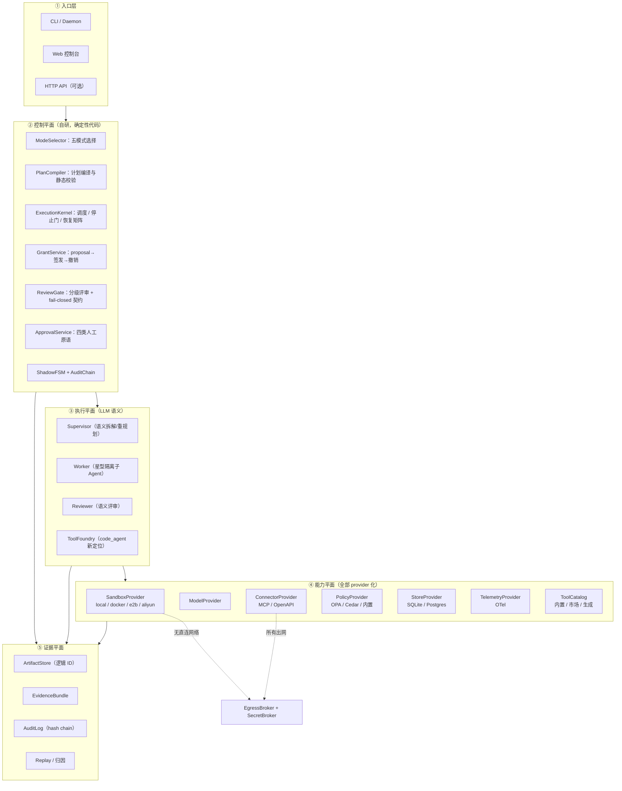
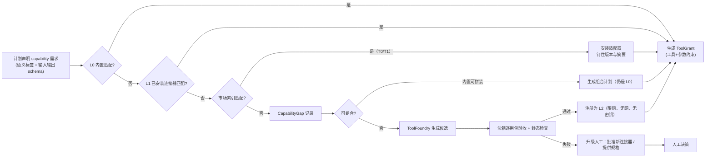

# SO-Agent 生产化重构设计（插件枢纽版）

> 状态：**部分实施中**。契约层与插件枢纽、Docker / Podman 容器沙箱后端、工具供给与生成生命周期、ModelGateway 多供应商故障转移、跨任务审计链与 OpenTelemetry 均已落地；Egress / Secret Broker、工具市场索引、参数级授权、云沙箱 / microVM、多租户与 Temporal 仍未实施。本文保留目标形态与迁移路线，作为后续工作的设计基线。
> 评审方式：先看第 0 节结论与第 13 节决策清单；未实施部分需确认范围后再推进。
> 数据来源：`docs/基准与稳定性报告.md`（真实 LLM 实测）、当前代码快照（2032 项测试）、GitHub 同类项目调研。

---

## 目录

0. [结论先行](#0-结论先行)
1. [现状诊断](#1-现状诊断)
2. [目标与非目标](#2-目标与非目标)
3. [总体架构：双平面 + 插件枢纽](#3-总体架构双平面--插件枢纽)
4. [模块拆分与开源选型](#4-模块拆分与开源选型)
5. [工具供给：三层 + 市场优先 + 缺口生成](#5-工具供给三层--市场优先--缺口生成)
6. [安全与权限模型](#6-安全与权限模型)
7. [协作效率与返工治理](#7-协作效率与返工治理)
8. [人工节点设计](#8-人工节点设计)
9. [插件接口草案](#9-插件接口草案)
10. [与现有代码的映射](#10-与现有代码的映射)
11. [迁移路线 P0–P5](#11-迁移路线-p0p5)
12. [验收标准与基准复跑](#12-验收标准与基准复跑)
13. [待决策清单](#13-待决策清单)
14. [附录：GitHub 同类项目对照](#14-附录github-同类项目对照)

---

## 0. 结论先行

**判断一：当前最大问题不是安全，而是"用错了执行模式"。**
实测中同一个复杂任务，原生 API 单轮 290 秒 / 2.15 万 tokens 完成，本项目 900 秒 / 26.5 万 tokens 未完成，其中 `code_agent` 单独占 65.7% tokens、单子任务 ST-001 占 597 秒 / 7 轮。这不是模型不行，而是把一个本质顺序的任务强行拆成多 Agent 并行 DAG，协调与评审开销超过了并行收益。**生产化的第一优先级是"由代码决定用不用多 Agent"，而不是继续优化多 Agent 本身。**

**判断二：`code_agent` 应降级为长尾工具工厂，而不是主力执行者。**
它作为工具存在是有意义的，但定位要改：日常能力由固定受治理工具覆盖（文件、HTTP、SQL、文档解析、数据处理），`code_agent` 只在"能力缺口"时被调用，产出物进入工具生命周期（生成→自证→验收→注册→毕业），而不是每次都临时写脚本。这一步能去掉基准中最大的一块 token 消耗。

**判断三：安全不能靠提示词，只能靠代码边界；而代码边界必须建立在成熟隔离技术之上。**
当前 `SandboxRunner` 只做工作目录路径隔离，README 已如实标注"不是安全边界"。生产化要求把它改为**三档 provider**（本机 OS 沙箱 / 容器或 microVM / 云沙箱），接口对齐成熟实现，不自造隔离。生成代码默认无网络、无密钥、只读根文件系统、非 root、一次性沙箱。

**判断四：工具策略既不是"全内置"也不是"开放市场"，而是"能力目录 + 信任分级 + 缺口生成"。**
全内置的组合爆炸不可维护，纯开放市场的供应链与凭证风险不可控。正确形态是：主管只声明**能力需求**（capability + schema），由代码侧解析器按"内置 → 已装连接器 → 市场索引 → 生成"顺序兜底，每一层都有信任等级、签名/摘要钉住、参数级授权与沙箱验收。联网能力一律经 **Egress Broker + Secret Broker**，生成代码永远拿不到网络与密钥，只能凭能力令牌调用已登记操作。

**判断五：本项目真正该自研的只有四件事，其余全部站在开源肩上。**
自研：① ToolGrant 全生命周期（proposal→评审→签发→撤销→补发）；② 两阶段评审的 fail-closed 契约；③ 失败分类/指纹/恢复矩阵；④ 影子 FSM 与真实执行的对账。这四件在开源生态里没有现成等价物。沙箱、策略引擎、网关、遥测、目录、持久化都应采购或适配。

**判断六：拆分的正确切法是"契约先行 + 能力 provider"，不是按文件拆。**
先冻结 `core/contracts`（数据结构、状态机、错误码、ID），再把内核与外围实现解耦为可替换 provider。这样即使将来换沙箱厂商、换模型、换数据库，业务代码零改动。

---

## 1. 现状诊断

### 1.1 已经做对、必须保留的资产

| 资产 | 位置 | 为什么值得保留 |
| --- | --- | --- |
| "LLM 思考 / 代码决策"的分工 | 全局 | 这是差异化，也是可审计性的来源 |
| 两阶段评审 + `passed` 唯一放行 | `aggregation_coordinator.py`、`planning_coordinator.py` | 评审结论不能由 LLM 自由裁量，必须代码校验 |
| 授权 proposal 后置签发 + 全出口撤销 | `runtime/permissions.py` | 比主流框架的"提示词约束"严格一个量级 |
| 确定性失败恢复 | `runtime/failure.py`、`fingerprint.py` | 低信任文本不可伪造失败类别，这一点开源无等价物 |
| 星型隔离（子 Agent 无互通） | `orchestrator.py` | 减少串扰与越权面 |
| 影子 FSM | `state_machine.py` | 审计可读性 |
| 停止门 + 五层超时 | `workflow.py`、`runtime/scheduler.py` | 长任务可控 |
| 动态工具的 test_cases 自证 | `runtime/generated_tool_runner.py` | 好的方向，需升级为独立生命周期 |

### 1.2 结构性问题

| 问题 | 证据 | 影响 |
| --- | --- | --- |
| 执行模式无选择器，复杂任务一律走多 Agent | 基准：顺序任务被拆成 2 子任务后 195.8s，单子任务 62.8s | 时间与 token 双输 |
| `code_agent` 承担主力编码 | 174,069 tokens（65.7%），ST-001 597s / 7 轮 | 单点成本与稳定性瓶颈 |
| 规划阶段即调用 `code_agent` | 规划期 46,616 tokens / 101.2s，随后计划被改写作废 | 纯浪费 |
| 评审是"全文重读 + 自由文本意见" | 48,607 tokens（18.3%） | 高开销、低信息密度、易空转 |
| 生产 token 台账只统计 supervisor/review | 82,765 / 265,010 = 31.2% | 成本不可观测，无法治理 |
| 路径/工作目录语义不一致导致重试 | `sandbox/fix-check-*` 历史证据 | 可静态拦截的错误被当成执行失败 |
| 模块按进程角色切分，未按契约切分 | `orchestrator.py` 体量大、耦合主管指令/工具/契约 | 难替换、难测试、难复用 |
| 沙箱不是安全边界 | README 已声明 | 不能运行不可信代码，封死生成工具的生产路径 |
| 无统一 provider 抽象 | 沙箱/模型/存储/策略均硬编码 | 无法接私有部署或云沙箱 |
| 上下文无预算 | 单轮输出无上限，长任务上下文膨胀 | 尾部延迟与成本不可控 |

### 1.3 与生产要求的差距矩阵

| 生产要求 | 当前 | 差距等级 |
| --- | --- | --- |
| 真实隔离 | 仅路径隔离 | 高 |
| 密钥隔离 | 环境变量注入，沙箱可见 | 高 |
| 出网治理 | 无 | 高 |
| 参数级授权 | 工具名级 | 中 |
| 成本可观测 | 31.2% 覆盖 | 高 |
| 成本可控 | 无预算 | 高 |
| 可回放/可审计 | 有事件日志，无 hash 链、无 trace 树 | 中 |
| 可替换实现 | 无 provider 层 | 高 |
| 人工介入 | 仅终态交接 | 高 |
| 稳定性 | 失败分类已做，但模式选择缺失 | 中 |

---

## 2. 目标与非目标

### 2.1 目标

1. **可维护**：契约层稳定，实现层可替换；单文件职责单一；新增一种沙箱/模型/存储不改业务代码。
2. **真安全**：不可信代码只在真隔离环境运行；默认无网、无密钥、只读根、非 root、一次性；所有出网经代理；权限在调用点校验而非提示词。
3. **稳定**：执行模式由代码选择；可静态判定的错误在执行前拦截；失败分类、指纹去重、恢复矩阵保留并强化；所有终态有明确出口。
4. **成本可控**：全链路 token/耗时归因 100% 覆盖；每任务硬预算；上下文按包投放而非全量拼接。
5. **可插拔**：沙箱、模型、连接器、存储、策略、遥测、评审、审批通道均为 provider；项目本体是编排与治理枢纽。
6. **工具可持续**：能力目录优先、市场优先、缺口生成兜底、毕业后沉淀。

### 2.2 非目标（本轮明确不做）

- 不做通用低代码平台（不与 Dify/n8n 竞争可视化编排）。
- 不自研 microVM / 内核隔离（用 Firecracker/gVisor/云厂商）。
- 不自建连接器 SaaS 平台（不做 OAuth 托管的多租户商业体）。
- 不在本轮引入 Temporal/Restate 等外部持久执行服务（保留接口，P5 再评估）。
- 不追求"完全无人值守"——高风险节点必须留人工闸门。

---

## 3. 总体架构：双平面 + 插件枢纽

### 3.1 五个层次



### 3.2 关键约束（架构不变量）

1. **控制平面不接受 LLM 指令**：LLM 只能提交候选（计划/结果/建议），控制平面按契约裁决。
2. **能力平面不感知业务**：provider 只实现 `exec / call / decide / store / emit`，不理解任务语义。
3. **执行平面无持久化权**：Agent 不直接写库、不直接发网络、不直接拿密钥，全部经能力平面代理。
4. **证据平面只追加**：审计链不可修改；产物以逻辑 ID 引用，路径由 ArtifactStore 统一解析（根治 cwd 不一致）。

### 3.3 建议目录结构

```text
src/so_agent/
  core/                    # 契约层：dataclasses / 状态机 / 错误码 / ID / 指纹
    contracts/             # TaskContract, SubtaskSpec, ReviewDecision, Evidence...
    fsm.py
    errors.py
  kernel/                  # 执行内核（自研核心）
    mode_selector.py
    plan_compiler.py
    scheduler.py
    gate.py                # PipelineGate
    grants.py              # GrantService
    recovery.py            # Classifier + Fingerprint + Policy matrix
    review_gate.py
    audit_chain.py
  planes/
    planning/  execution/  aggregation/
  capabilities/            # provider 实现（可独立发布）
    sandbox/{base.py,local.py,docker.py,e2b.py,aliyun.py}
    model/{base.py,openai_compat.py}
    connector/{base.py,mcp.py,openapi.py}
    policy/{base.py,builtin.py,opa.py}
    store/{base.py,sqlite.py,postgres.py}
    telemetry/{base.py,otel.py}
  catalog/                 # 能力解析与信任分级
    resolver.py
    trust.py
    lifecycle.py
  connectors/              # ConnectorSpec 编译器 + 出网/密钥代理
    spec.py
    egress.py
    secrets.py
  hitl/                    # 审批原语与通道
  plugins/                 # manifest 加载、版本兼容、entry points
  api/  web/  cli/
```

---

## 4. 模块拆分与开源选型

### 4.1 选型总表

| 能力 | 决策 | 采用方案 | 理由 | 成本/风险 |
| --- | --- | --- | --- | --- |
| Agent 运行时基座 | **保留** | OpenAI Agents SDK（现有依赖） | 已在用，迁移成本最低 | 需锁定版本 |
| 沙箱（云） | **适配** | E2B / 阿里云沙箱 / 火山 AgentKit（provider 三选一） | 真 microVM 隔离，省自研 | 数据出境、按量计费 |
| 沙箱（本地低信任） | **适配** | anthropics/sandbox-runtime（seatbelt/bubblewrap/WFP） | 默认禁网 + 写白名单 + Windows 支持 | Node 运行时依赖 |
| 沙箱（容器） | **适配** | Docker + 自定 seccomp/只读根/非 root | 私有部署标准做法 | 需宿主加固 |
| 策略决策 | **适配** | OPA（HTTP/JSON，Python 友好）；严谨场景可选 Cedar | 工具+参数级授权、策略可测可版本化 | Rego 学习曲线 |
| 连接器网关 | **适配** | agentgateway / mcp-gateway | 传输、认证、限流、会话复用 | 只做传输，授权仍自研 |
| 工具目录 | **适配** | MCP Registry 规范（server.json、命名空间） | 目录格式标准化，便于接市场 | 仅 server 级，tool 级索引自研 |
| 协议 | **采用** | MCP（已有四层实现） | 事实标准，生态最大 | 保持双向适配器 |
| 遥测 | **适配** | OpenTelemetry GenAI semconv + OpenLLMetry；本地 UI 用 Phoenix | token/trace 归因开箱即用 | semconv 仍 experimental，需锁版本 |
| 持久化 | **保留接口** | 现 SQLite；provider 抽象预留 Postgres | 当前规模够用，别过早引入 | 迁移需数据层抽象 |
| 编排持久执行 | **暂缓** | 保留接口，P5 评估 Temporal/DBOS | 运维重，当前不需要 | — |
| 结构化输出 | **采用** | Pydantic v2 严格模型 | 替代手写字段校验 | 必须保持 fail-closed 不放宽 |
| 插件清单 | **借鉴** | Dify 插件 manifest + n8n 凭据同包 | 成熟的分发与权限声明形态 | 只借形态，不引运行时 |
| 治理拦截 | **借鉴** | Microsoft AGT 的 `govern(tool)→审计→拒绝` | 与 ToolGrant 天然同构 | 不引入其 SDK |

### 4.2 明确"不重复造轮子"的清单

- **隔离技术**：不自研 namespace/seccomp/cgroup，直接用 OS 原语或云沙箱。
- **OAuth / 凭证刷新**：不自研授权码流程，交给连接器网关或 Composio 类托管（可选）。
- **MCP 协议**：不自研传输与握手，已有实现继续用并跟随上游。
- **策略语言**：不自研 DSL，用 Rego 或 Cedar。
- **分布式追踪**：不自研 span 模型，对齐 OTel GenAI semconv。
- **数据库迁移**：保留现有顺序增量迁移，不引入 Alembic 这类重型 ORM 迁移（当前无 ORM）。
- **向量检索/语义匹配**：市场能力匹配若需 embedding，用现成 embedding 服务，不自研索引。

### 4.3 明确"必须自研"的清单

| 自研项 | 为什么没有替代 |
| --- | --- |
| Grant 生命周期状态机 | OPA/Cedar 只回答 allow/deny，不管签发、过期、撤销、补发、审计关联 |
| 评审 fail-closed 契约 | Instructor/Pydantic AI 是"校验+重试"，不是"字段缺失即整单拒绝" |
| 失败分类 + 指纹 + 恢复矩阵 | 无开源等价物；且必须保证低信任文本不能改类别 |
| 影子 FSM 对账 | 无现成方案 |
| 能力缺口 → 生成 → 验收 → 毕业 闭环 | MCP Registry 只做目录发现 |
| 星型强隔离拓扑 | 主流框架都鼓励 handoff/group chat，方向相反 |

---

## 5. 工具供给：三层 + 市场优先 + 缺口生成

### 5.1 三层供给

| 层 | 内容 | 准入规则 | 典型例子 |
| --- | --- | --- | --- |
| **L0 内置受治理工具** | 高频、高风险、需代码级拦截的能力 | 由项目维护，随版本发布，参数级校验 | 沙箱内文件读写、HTTP 取数（经代理）、SQL 查询（只读）、文档解析、表格/统计、代码执行 |
| **L1 连接器（市场/自建）** | 外部系统能力 | ConnectorSpec 声明 + 信任等级 + 摘要钉住 | GitHub、Jira、飞书、企业数据库、对象存储、搜索 API |
| **L2 生成工具** | 长尾、一次性、内部逻辑 | 缺口触发，沙箱自证 + 代码验收，限期有效 | 特定格式转换、专有算法、企业内部脚本 |

**为什么不全内置**：长尾无限、认证方式各异、外部 API 持续变更，内置等于把别人的维护负担搬进自己仓库。
**为什么不纯开放市场**：供应链投毒、schema 漂移、凭证外泄、质量参差，且市场无法保证"参数级最小权限"。
**结论**：**目录优先、市场优先、生成兜底、毕业后沉淀**。L2 不是常态路径，是缺口路径。

### 5.2 能力解析流程（代码驱动）



要点：

- 计划里写的是**能力**不是工具名，避免"计划引用了不存在的工具"这类失败。
- 解析发生在**计划评审通过之后、执行之前**，属于代码层，可静态完成，不消耗 LLM。
- 缺口记录是产品资产：同一缺口重复出现 N 次，触发"毕业"评审，转为 L0/L1。

### 5.3 联网工具怎么解决（关键设计）

生成工具**永远不直连网络**。规则：

1. 生成工具只能做纯计算 + 文件读写（沙箱内）。
2. 需要外部数据时，工具代码里只能声明"我要调用某个**已登记连接器操作**"，运行时由 EgressBroker 代为发起。
3. 能力令牌（capability token）限定：目标主机、路径、方法、QPS、有效期、可读字段。
4. SecretBroker 在出网瞬间注入凭证，**凭证不进沙箱、不进 LLM 上下文、不进日志**。
5. 出网前做 SSRF 防护：禁止链路本地、云元数据地址、内网段（除非显式白名单）、非标准端口、重定向跨域。
6. 所有出网请求留审计（脱敏后），可按 trace 回放。

这样"工具写不完"的问题被转化为"连接器登记 + 能力令牌"，而连接器是可复用、可治理、可分发的资产，不是一次性代码。

### 5.4 工具生命周期

```text
生成路径：proposed → built → self_tested → verified → registered(L2) → graduated(L1/L0)
外部分发：discovered → installed → verified → granted → active → deprecated → revoked
```

- L2 默认**限期 + 绑定任务**，任务结束即失效；连续成功 N 次且通过评审才可"毕业"。
- 毕业评审看三件事：复用次数、参数约束是否可静态表达、是否有稳定的 test_cases。
- 任何工具版本变更都要重新验收，摘要变化即失效。

### 5.5 信任分级

| 等级 | 来源 | 运行限制 | 授权 |
| --- | --- | --- | --- |
| T0 | 项目内置 / 官方签名 | 正常 | 自动签发 |
| T1 | 已验证社区连接器 | 沙箱 + 出网白名单 | 自动签发（参数级约束） |
| T2 | 本地生成工具 | 沙箱、无网、无密钥、限期 | 任务级签发 |
| T3 | 未验证来源 | 默认拒绝 | 逐次人工批准 |

---

## 6. 安全与权限模型

### 6.1 威胁模型

| 威胁 | 载体 | 防线 |
| --- | --- | --- |
| 提示注入篡改决策 | 工具返回、网页、文档 | 低信任文本不能改状态/类别/授权；所有决策在代码层 |
| 生成代码逃逸 | L2 工具 | 真隔离沙箱；无网无密钥只读根；一次性 |
| 供应链投毒 | 市场插件 | 签名 + 摘要钉住 + 信任分级 + 验收 |
| 凭证外泄 | 沙箱、日志、LLM 上下文 | SecretBroker 注入；日志脱敏；上下文裁剪 |
| 越权调用 | 子 Agent | 调用点校验 grant；参数级约束；不可转授 |
| 数据外传 | 出网 | EgressBroker 白名单 + DLP 规则 |
| 资源耗尽 | 恶意代码/死循环 | cgroup/超时/输出上限/一次性回收 |
| 审计篡改 | 内部 | hash chain 只追加 |

### 6.2 十条安全不变量（全部 fail closed）

1. 密钥绝不出现在 LLM 上下文、沙箱文件系统、日志与产物中。
2. 所有出网只经 EgressBroker；默认拒绝；按任务白名单。
3. 不可信代码只在隔离等级 ≥ 容器的沙箱中运行；非 root、只读根、资源上限、一次性。
4. Grant 按任务签发、含参数约束、有到期时间、可即时撤销；在**调用点**校验。
5. 计划不能扩大权限；只有 GrantService 在评审通过后签发。
6. 失败类别只能由代码侧证据推导；不可信文本不能设置类别。
7. 评审放行需要机器可校验的契约；契约无效、解析失败一律判不通过。
8. 每次状态迁移、授权、工具调用、出网、人工决策都入审计链，带 trace id。
9. 未知插件、未知版本、摘要不匹配一律拒绝。
10. 停止门触发后拒绝一切新动作，隔离迟到结果，撤销未完成授权。

### 6.3 权限模型

在现有"任务—Agent—工具"三元组上增加两个维度：

```text
Grant = (principal, action, resource, context, constraints, expiry)
principal : agent_id + task_id + plan_version
action    : tool_name.operation
resource  : 具体对象（文件根、表名、URL 前缀、连接器操作）
context   : 风险等级、审批记录、预算余量
constraints: 参数白名单/正则、QPS、单次输出上限、只读
```

决策点在工具包装器入口（借鉴 AGT 的 `govern(tool)` 形态）：先判定 → 记录 → 执行或拒绝。策略实现可换 OPA，但 **Grant 的签发与撤销必须留在自研内核**。

### 6.4 沙箱三档

| 档位 | 实现 | 用途 | 默认策略 |
| --- | --- | --- | --- |
| S1 本机 OS 沙箱 | seatbelt / bubblewrap / Windows WFP | 开发、验收低风险生成工具 | 禁网、写白名单 |
| S2 容器 | Docker + seccomp + 只读根 + 非 root | 私有部署默认 | 禁网、内存/CPU/时长上限 |
| S3 microVM / 云沙箱 | E2B / 阿里云 / 火山 | 不可信代码、生产默认 | 无网、一次性、快照恢复 |

选择由**风险等级 + 部署配置**共同决定，不由 LLM 决定。provider 接口统一，切换只改配置。

---

## 7. 协作效率与返工治理

### 7.1 返工的四个真实根因（来自实测）

1. **模式错配**：顺序任务被拆成并行 DAG，多 Agent 只增加了协调成本。
2. **规划期提前执行**：计划还没定稿就调用 `code_agent`，产物随后作废（46,616 tokens）。
3. **评审空转**：评审读全文、给自由文本意见，缺少可机检的验收标准，导致"通过了但没完成"或"反复修改"。
4. **可静态发现的错误被当作执行失败**：路径/工作目录语义、工具不存在、schema 不兼容，本应在执行前拦截。

### 7.2 效率模型与模式选择

```text
单 Agent：   T ≈ Σ t_i + T_tools
多 Agent：   T ≈ 关键路径 + T_coord + T_review + T_sync
多 Agent 有收益的条件：并行可缩短量 > 协调 + 评审 + 同步开销
```

`ModeSelector` 在拆解前由代码判定（输入：依赖图形态、风险等级、预算、历史同类任务统计）：

| 模式 | 触发条件 | 评审策略 |
| --- | --- | --- |
| Direct | 不需要工具、答案可一次给出 | 无 |
| Single-Agent | 有工具调用但任务顺序 | 结果契约校验 |
| Pipeline | 可分解为固定阶段（取数→处理→输出） | 阶段间契约校验 |
| Multi-Agent | DAG 宽度 ≥ 2 且并行收益显著 | 分级评审 |
| Safe-Review | 高风险（写外部系统/不可逆） | 强制人工闸门 |

**默认不启用 Multi-Agent。** 只有当估算收益超过阈值（建议 ≥ 1.5×）且依赖图确实可并行时才启用。这一条单独就能避免基准中大部分浪费。

### 7.3 通信协议：用结构化对象替代自由文本

四类消息，全部有 schema：

| 消息 | 方向 | 内容 | 用途 |
| --- | --- | --- | --- |
| `TaskContract` | 主管 → 子 Agent | 目标、非目标、约束、**可机检验收标准**、输入、期望产物、预算、截止 | 消除"做到什么程度"的歧义 |
| `EvidenceBundle` | 子 Agent → 主管/评审 | 产物逻辑 ID、执行的检查与结果、关键日志摘要、未决风险 | 评审看证据不看散文 |
| `CapabilityGap` | 子 Agent → 主管 | 缺什么能力、期望输入输出、已尝试方案 | 触发解析/生成，避免反复试错 |
| `FailureReport` | 子 Agent → 主管 | 代码侧证据、失败类别、已尝试次数、建议 | 驱动恢复矩阵，不再靠文本猜 |

**通信纪律**：子 Agent 之间零通道；一切经主管；每次交互必须携带 `subtask_id + plan_version + fingerprint`，防止版本串台。

### 7.4 反返工机制

1. **契约先行**：计划阶段就把验收标准写成可执行检查（测试/断言/schema），不能机检的必须显式标注"需人工判定"。
2. **计划编译**：把 LLM 计划编译为 DAG，静态校验六项——工具/能力存在性、依赖无环、输入输出 schema 兼容、预算可行、路径语义一致、验收检查可执行。失败只允许**一次结构化修复**，不整单重规划。
3. **增量验证**：子任务返回前自检，失败必须带结构化诊断，禁止"盲目重试"。
4. **产物逻辑 ID**：所有文件经 ArtifactStore 解析绝对路径，根治 cwd/相对路径问题。
5. **结果复用**：以 `subtask_fingerprint + 输入摘要` 为键缓存；重规划时显式 `reuse_from`。
6. **评审只看增量**：结果评审聚焦"自上次评审以来的变更 + 验收检查结果"，不重读全文。
7. **评审分级**：L0 确定性检查（永远执行，零 LLM 成本）→ L1 语义验收（仅一次）→ L2 人工（高风险）。
8. **预算前置**：任务开始即分配 token/时间预算，子任务超支先降级（减少轮次/换小模型/裁剪上下文），而不是等超时。

**当前实现进度**：可机检验收规则（文件/JSON/数值/文本/退出码）、code_agent 后置条件、子任务工具证据、结果评审分级（`always` / `risk_based` / `off`）与低风险异步 provisional 交付已落地；契约编译、ArtifactStore 等其余条目仍为设计方向。

### 7.5 上下文与成本治理（原"暂缓项"，生产化必须补）

- **ContextPack**：每个 Agent 只接收与当前子任务相关的片段（目标、约束、上游产物摘要、相关工具 schema），不拼接全局历史。
- **分层摘要**：超过阈值时，由代码触发"压缩到结构化摘要"，保留决策与证据，丢弃过程性文本。
- **硬预算**：任务级、阶段级、Agent 级三层 token 上限；超限进入降级路径（这是代码决策）。
- **全链路归因**：所有 Agent（含嵌套 code_agent）的 usage 都进台账，修复当前 31.2% 覆盖的问题。

**当前实现进度**：确定性裁剪与压缩（`prune_empty`、按阶段载荷审计、保护编号/路径/验收规则的压缩）、工具与代码 Agent 输出截断、评审输入输出治理、任务级 token 双阈值熔断（总量 800k / 单 Agent 400k，默认启用）已落地；成本/时间等多维预算硬限额、超限降级与模型驱动分层摘要仍暂缓。

---

## 8. 人工节点设计

### 8.1 原则

人工只处理四类：**不可逆**、**高风险**、**低置信/冲突**、**合规要求**。其余一律自动。目标是把人工从"逐步确认"变成"关键闸门"。

### 8.2 四种交互原语

| 原语 | 语义 | 典型场景 | 默认动作 |
| --- | --- | --- | --- |
| `Approve` | 是/否放行 | 部署、删除、付款、批量外发 | 超时拒绝 |
| `Choose` | 多方案选择 | 供应商选型、架构取舍、数据源选择 | 超时选保守项 |
| `Provide` | 补充缺失输入 | 凭证、业务口径、访问授权 | 超时挂起 |
| `Review` | 验收交付物 | 高风险产物、对外文档 | 超时拒绝 |

### 8.3 审批矩阵

| 触发条件 | 原语 | 阻塞点 | 上下文包 |
| --- | --- | --- | --- |
| 首次接入新连接器 / OAuth 授权 | Provide + Approve | 执行前 | 连接器规格、权限范围、数据流向 |
| 生成工具毕业为 L1/L0 | Review | 注册前 | 代码、test_cases、失败率、复用次数 |
| 高风险动作（写生产、删除、外发） | Approve | 调用前 | 参数、影响范围、回滚方案 |
| 重规划额度耗尽 | Choose + Review | `human_required` | 计划历史、失败证据、建议 |
| 评审冲突（评审拒绝但执行方坚持） | Choose | 汇总前 | 双方证据、验收检查结果 |
| 预算超支且无法降级 | Approve | 超支点 | 已消耗、剩余工作、预估 |
| 策略拒绝但存在豁免场景 | Approve | 调用前 | 策略命中项、豁免理由 |

### 8.4 节点形态与工程要求

- **异步可恢复**：人工节点不占进程；任务状态持久化，恢复后从断点继续（对齐 RunState/interrupt 语义）。
- **决策留痕**：谁、何时、依据什么、批准了什么范围，全部入审计链。
- **豁免范围受限**：批准是"一次性 + 指定参数范围"，不产生长期放权；可配置"同类自动批准 N 次"但必须显式。
- **防审批疲劳**：同类低风险请求批量合并；高频决策沉淀为策略规则，而不是每次都问人。
- **全部节点有默认动作**：默认必须是安全侧（拒绝/挂起），不允许"无人值守自动通过"。

---

## 9. 插件接口草案

### 9.1 六类 provider

```python
class SandboxProvider(Protocol):
    def capabilities(self) -> SandboxCapabilities: ...      # isolation, network, snapshot
    def create(self, spec: SandboxSpec) -> SandboxSession: ...

class SandboxSession(Protocol):
    def exec(self, cmd: list[str], *, timeout: float) -> ExecResult: ...
    def read(self, path: str) -> bytes: ...
    def write(self, path: str, data: bytes) -> None: ...
    def close(self) -> None: ...

class ConnectorProvider(Protocol):
    def operations(self) -> list[OperationSpec]: ...
    def call(self, op: str, args: dict, *, credential: CredentialRef) -> OperationResult: ...

class PolicyProvider(Protocol):
    def decide(self, req: PolicyRequest) -> PolicyDecision: ...  # allow/deny/approval + obligations

class StoreProvider(Protocol):
    # tasks / executions / plans / artifacts / audit
    ...

class TelemetryProvider(Protocol):
    def emit(self, event: AuditEvent | Span) -> None: ...
```

模型 provider、评审 provider、审批通道同理。所有 provider 只依赖 `core/contracts`，不反向依赖 kernel。

### 9.2 插件清单

```yaml
id: sandbox.e2b
version: 0.3.0
kind: sandbox
entrypoint: so_agent_e2b:provider
api_version: "1"
capabilities: [microvm, snapshot, network_policy]
permissions: [network_egress]
config_schema: ./schema.json
signature: <digest>
compatibility: ">=1.0,<2.0"
```

规则：版本不兼容直接拒绝；摘要不匹配拒绝；插件只能申请清单声明的权限；插件崩溃不能拖垮内核（进程隔离或异常边界）。

### 9.3 兼容策略

- `api_version` 主版本变更 = 破坏性，旧插件拒绝加载。
- provider 实现按 `release line` 维护，而不是逐个适配。
- 内核只依赖抽象，集成测试对每个 provider 跑同一套一致性用例。

---

## 10. 与现有代码的映射

| 现有文件/模块 | 处置 | 去向 |
| --- | --- | --- |
| `runtime/failure.py`、`fingerprint.py` | **保留 + 强化** | `kernel/recovery.py` |
| `runtime/permissions.py` | **重构** | `kernel/grants.py`（加参数级约束、生命周期） |
| `state_machine.py` | **保留** | `core/fsm.py` + `kernel/audit_chain.py` |
| `planning_coordinator.py` | **拆分** | `planes/planning/` + `kernel/plan_compiler.py` |
| `execution_coordinator.py` | **拆分** | `planes/execution/` + `kernel/scheduler.py` |
| `aggregation_coordinator.py` | **拆分** | `planes/aggregation/` + `kernel/review_gate.py` |
| `orchestrator.py` | **瘦身** | 主管提示词与工具声明移入 `planes/planning/prompts.py`；契约移入 `core/contracts/` |
| `workflow.py` | **保留骨架** | `kernel/` 主循环 + 组件装配 |
| `runtime/sandbox.py` | **替换** | `capabilities/sandbox/*`（三档 provider） |
| `runtime/tool_registry.py` | **扩展** | `catalog/` + `connectors/` |
| `runtime/generated_tool_runner.py` | **重写** | `catalog/lifecycle.py` + 沙箱验收 |
| `mcp/*` | **保留** | `capabilities/connector/mcp.py` 适配 |
| `persistence.py`、`schema_migrations.py`、`result_store.py` | **保留 + 抽象** | `capabilities/store/sqlite.py` |
| `runtime/events.py` | **扩展** | `capabilities/telemetry/otel.py` + hash chain |
| `router.py`、`paths/*` | **保留 + 重构** | `kernel/mode_selector.py` |
| `web/*` | **保留** | 增加审批节点与归因视图 |
| `config.py` | **拆分** | 内核配置 / provider 配置分离 |

**删除项**：`orchestrator.py` 中与主管提示词混在一起的契约常量；重复的 JSON 手写校验；`sandbox/` 下自建执行器的网络与路径假设。

---

## 11. 迁移路线 P0–P5

> 每个阶段都必须"可独立上线 + 可回滚"，且不改变外部行为的前提下先做结构性改造。

### P0 观测与基线（1 周量级）

- 目的：先能看见，再谈优化。
- 内容：全链路 token/耗时归因补齐（含嵌套 Agent）；审计事件加 trace id；固定评测集（10 个任务，覆盖 5 种模式与 3 个风险等级）；记录基线。
- 验收：任一任务可导出完整归因树；归因覆盖率 100%；评测集可一键复跑。
- 风险：低。

### P1 契约与拆分（2–3 周）

- 目的：结构可维护，行为不变。
- 内容：抽 `core/contracts`；抽 provider 接口（先只做接口与现有实现适配）；拆分三个协调器；`orchestrator.py` 瘦身。
- 验收：全部现有测试通过；黄金用例输出与 P0 基线一致（允许非确定性差异在容差内）；新增 provider 只需新增一个文件。
- 风险：中（重构面大），用"行为快照 + 双跑对比"控制。

### P2 安全主干（2–3 周）

- 目的：把沙箱变成真边界。
- 内容：三档 SandboxProvider；EgressBroker + SecretBroker；Grant v2（参数级 + 到期 + 撤销）；策略 provider 接入（先内置，OPA 可选）；安全测试套件（逃逸、密钥外泄、SSRF、越权）。
- 验收：安全不变量 10 条逐条有自动化测试；生成工具在沙箱内无法访问网络与密钥；撤销后调用立即失败。
- 风险：高（涉及平台差异），需在 Windows/Linux 分别验证。

### P3 工具供给（3–4 周）

- 目的：解决"工具写不完"。
- 内容：CapabilityResolver；MCP Registry 接入；ConnectorSpec → 工具编译；ToolFoundry 与工具生命周期/毕业；信任分级。
- 验收：给定一个未内置能力，系统能自动走"市场匹配 → 安装 → 授权 → 调用"；无匹配时走"生成 → 验收 → 注册 → 限期使用"；两种路径都有审计。
- 风险：中高（外部依赖多），先做 2 个连接器样例。

### P4 效率（2–3 周）

- 目的：复杂任务更快、更省、少返工。
- 内容：ModeSelector；PlanCompiler；TaskContract/EvidenceBundle；分级评审；ContextPack + 硬预算；结果复用。
- 验收：同一基准任务完成率与成本达到第 12 节目标；顺序任务不再进入 Multi-Agent。
- 风险：中（模式判定阈值需调），用评测集回归。

### P5 人工与运维（2 周）

- 目的：可运营。
- 内容：四类审批原语 + 通道（Web/CLI）；暂停恢复；回放与归因视图；成本看板；可选评估 Temporal/DBOS。
- 验收：高风险任务必须经人工闸门；中断后可恢复；任一历史任务可回放关键决策。
- 风险：低。

---

## 12. 验收标准与基准复跑

### 12.1 功能验收

- 5 种模式各有通过用例；模式选择可解释（给出判定依据）。
- 工具三条路径（内置 / 连接器 / 生成）各有端到端用例。
- 人工节点 4 种原语各有用例，含超时默认动作。
- 任一任务可导出：计划版本、授权记录、工具调用、出网记录、评审证据、决策链。

### 12.2 安全验收

- 沙箱逃逸测试集全部拒绝（读宿主文件、写宿主、起网络、提权、耗尽资源）。
- 密钥泄露测试：扫描上下文、日志、产物、沙箱文件系统，零命中。
- SSRF 测试集（元数据地址、内网段、重定向、DNS 重绑定）全部拦截。
- 越权测试：无 grant、过期 grant、跨任务 grant、参数越界，全部拒绝。
- 提示注入测试：工具返回恶意文本，不能改变状态、类别、授权。

### 12.3 性能与成本目标（同一基准任务，真实 LLM）

| 指标 | 当前 | P2 目标 | P4 目标 |
| --- | --- | --- | --- |
| 完成率 | 未完成 | ≥ 80% | ≥ 90% |
| 墙钟时间 | 900s | ≤ 600s | ≤ 400s |
| 总 tokens | 265k | ≤ 150k | ≤ 100k |
| 归因覆盖率 | 31.2% | 100% | 100% |
| 顺序任务误入 Multi-Agent | 是 | 否 | 否 |

说明：目标以"同题、同模型、同硬件"复跑为准；不承诺绝对值，只承诺相对改进与不退化。

### 12.4 回归要求

- 每次阶段交付必须跑完整评测集，并附归因对比。
- 任一指标退化超过 10% 需在合并前解释并修复。

---

## 13. 待决策清单

请逐条确认，未确认项按"暂不实施"处理。

| 编号 | 决策点 | 选项 | 建议 |
| --- | --- | --- | --- |
| D1 | 是否接受"默认关闭多 Agent" | 接受 / 保留现状 | **接受**（最大收益点） |
| D2 | `code_agent` 定位 | 主力执行者 / 长尾工具工厂 | **长尾工具工厂** |
| D3 | 沙箱首选档位 | 本机 OS / 容器 / 云 | **容器为默认，云为可选，本机仅开发** |
| D4 | 是否引入 OPA | 引入 / 先内置策略 | **先内置，P2 后评估 OPA** |
| D5 | 是否引入 OTel | 引入 / 自建事件 | **引入**（归因与回放刚需） |
| D6 | 工具市场形态 | 纯内置 / 纯开放 / 分层 | **分层（L0/L1/L2）** |
| D7 | 生成工具毕业门槛 | 次数 / 评审 / 两者 | **两者（次数 + 评审）** |
| D8 | 人工节点范围 | 全量确认 / 四类闸门 | **四类闸门** |
| D9 | 是否本轮引入 Temporal | 引入 / 保留接口 | **保留接口，P5 评估** |
| D10 | 是否接受"每阶段可独立上线" | 接受 / 一次性重构 | **接受** |

---

## 14. 附录：GitHub 同类项目对照

### 14.1 编排与运行时

| 项目 | 定位 | 可借鉴 | 不照搬 |
| --- | --- | --- | --- |
| LangGraph | 图/状态机编排 | checkpointer + interrupt 的暂停恢复；子图隔离 | 分支决策交给 LLM 条件边，与本项目相反 |
| Temporal | 持久执行 | workflow/activity = 决策/副作用分离；信号做 HITL | 确定性编程约束重、运维重 |
| OpenAI Agents SDK | 轻量运行时（本项目基座） | SandboxAgent 多 provider、RunState 暂停恢复、tracing | handoff 让 LLM 自选 Agent，破坏星型隔离 |
| Microsoft Agent Framework | 图工作流 | checkpoint/resume、`request_info` 人工节点 | 图需预定义，动态重规划弱 |

### 14.2 沙箱

| 项目 | 可借鉴 | 风险 |
| --- | --- | --- |
| E2B | provider 抽象、快照、网络策略 | 云依赖与成本 |
| microsandbox | 自托管 microVM、MCP 原生 | 默认放行网络，需收紧 |
| anthropics/sandbox-runtime | 默认禁网 + 域名白名单 + Windows WFP | 仅进程级隔离 |
| DifySandbox | seccomp 白名单 + 禁网跑用户代码 | 语言与场景受限 |

### 14.3 工具与策略

| 项目 | 可借鉴 | 缺口 |
| --- | --- | --- |
| MCP Registry | 目录格式、命名空间、发布校验 | 无 tool 级索引、无信任评分、无生成闭环 |
| Composio / Pipedream | 按用户存凭证、schema 归一 | 托管依赖、凭证在第三方 |
| OPA / Cedar | 参数级授权、策略可测 | 不管签发/撤销/生命周期 |
| agentgateway | MCP/A2A 代理、认证、限流 | 只做传输与粗粒度鉴权 |

### 14.4 观测与插件化

| 项目 | 可借鉴 | 说明 |
| --- | --- | --- |
| OTel GenAI semconv | span 与 usage 语义 | 仍 experimental，需锁版本 |
| Phoenix / Langfuse | trace 回放、成本归因 | Langfuse 组件重，单机选 Phoenix |
| Dify 插件体系 | 清单、权限声明、进程外运行、签名 | 只借形态 |
| n8n | 凭据声明与节点同包 | 借封装方式 |
| Backstage | 插件版本 release line | 面向 UI，不直接用 |

### 14.5 思想相近

| 项目 | 借鉴点 |
| --- | --- |
| Microsoft AGT | `govern(tool)` 入口拦截 → 审计 → 拒绝，与 Grant 同构 |
| Apache Burr | State/Action/Transition + persister，FSM 即应用本体 |
| Restate / DBOS | 重试与恢复作为运行时语义，而非散落分支 |
| CrewAI Flow | `@router` 显式化分支，避免 LLM 选边 |
| OpenHands | confirmation mode + 调用前安全分析 |
| Voyager | 技能库 + 自验证 + 迭代修复（动态工具生成最早先例） |

### 14.6 开源空白（= 本项目自研价值）

1. 能力缺口 → 生成 → 验收 → 注册 → 毕业的闭环。
2. 评审契约的 fail-closed 语义。
3. 低信任文本不可伪造失败类别。
4. Grant 全生命周期状态机。
5. 星型强隔离拓扑。
6. 影子 FSM 与真实执行的对账。

---

## 附：本文件的边界

- 本文不含代码改动，不改变当前仓库行为。
- 选型中的具体版本、许可证、部署成本需在 P0/P1 阶段做 spike 验证后最终确认。
- 性能目标基于单次实测与估算，需在 P0 建立评测集后用多轮结果校准。
